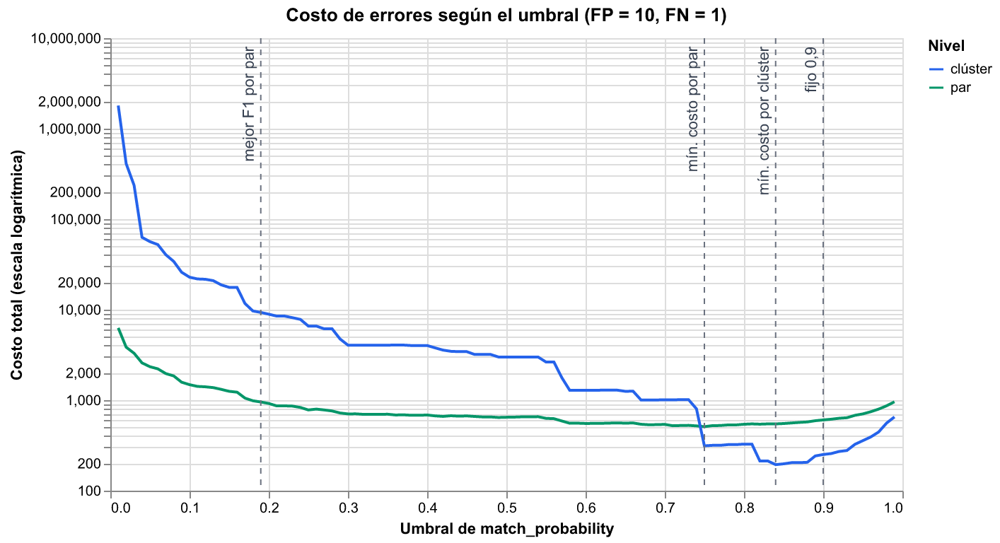
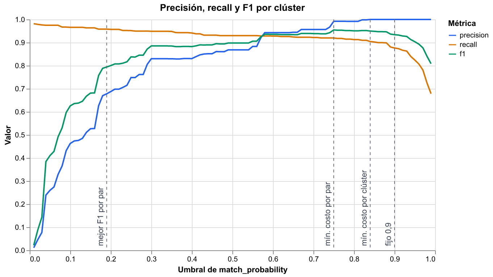

# Resolución de identidades con Splink

Caso de uso 1 de un portafolio de ciencia de datos y agentes aplicado a banca: **calidad del
dato y resolución de identidades**.

**Tableros interactivos:** [stous1.github.io/identity-resolution](https://stous1.github.io/identity-resolution/)

## Qué problema resuelve

En una base de clientes, la misma persona aparece varias veces con pequeñas diferencias: un
dígito errado en el documento, un nombre sin tilde, un teléfono viejo. Eso infla el número de
clientes, duplica comunicaciones y esconde relaciones de riesgo.

Este proyecto detecta qué registros corresponden al mismo cliente con un modelo probabilístico
Fellegi-Sunter (con [Splink](https://github.com/moj-analytical-services/splink) sobre DuckDB),
**entrenado sin etiquetas**, explica cada decisión campo por campo y mide su precisión contra
la verdad conocida.

Descripción completa del caso: [docs/caso-01-identidades.md](docs/caso-01-identidades.md).

## Hito 1: fake_1000 de punta a punta

Dataset de demostración de Splink: 1.000 registros de 251 personas, con errores de digitación,
campos vacíos y variaciones de nombres. La columna `cluster` (quién es quién) **solo se usa
para evaluar**.

**Modelo**

- Comparaciones: nombre y apellido (Jaro-Winkler con ajuste por frecuencia), fecha de
  nacimiento (niveles por distancia), ciudad (exacta con ajuste por frecuencia) y correo.
- Entrenamiento sin etiquetas: λ con reglas determinísticas, *u* por muestreo aleatorio y *m*
  con EM en dos pasadas (bloqueo por nombre+apellido y por fecha de nacimiento).
- Bloqueo de predicción: 4 reglas exactas (nombre, apellido, fecha de nacimiento, correo) y
  6 aproximadas (ver abajo). Se comparan 7.110 pares en vez de ~500.000.

**Resultados** (umbral de operación 0,84, el de menor costo por clúster)

| Nivel | Precisión | Recall | F1 |
|---|---|---|---|
| Por par | 1,000 | 0,731 | 0,844 |
| Por clúster (pares inducidos) | 1,000 | 0,904 | 0,950 |

- **Recall del bloqueo:** 92,4 % de los 2.031 pares verdaderos llegan a compararse.
- **Clústeres:** 306 predichos frente a 251 personas reales; 205 personas (81,7 %) quedan
  reconstruidas exactamente. Ningún clúster mezcla personas distintas: los errores que quedan
  son personas divididas en varios clústeres.

Métricas completas: [docs/resultados/metricas.json](docs/resultados/metricas.json).

### Bloqueo aproximado

Con solo reglas exactas, el 18,8 % de los pares verdaderos nunca se compara porque no comparte
ningún campo idéntico (por ejemplo, un apellido mal escrito y una fecha con un dígito
cambiado, con el correo vacío). Las reglas aproximadas recuperan parte de esos pares:

- Soundex del apellido y Metaphone del nombre (calculados con
  [jellyfish](https://github.com/jamesturk/jellyfish)).
- Año de nacimiento + inicial del apellido, y año de nacimiento + inicial del nombre.
- Primeros 4 caracteres del correo.
- Ciudad + año de nacimiento.

Cada regla se midió sumada a las exactas y en conjunto
([comparacion_bloqueos.csv](docs/resultados/comparacion_bloqueos.csv)), con el umbral de
operación:

| Bloqueo | Comparaciones | Recall del bloqueo | Precisión por clúster | Recall por clúster | Personas exactas |
|---|---|---|---|---|---|
| Solo exactas | 3.989 | 0,812 | 1,000 | 0,853 | 185 |
| Exactas + inicio del correo | 4.520 | 0,884 | 1,000 | 0,885 | 197 |
| Exactas + Soundex del apellido | 5.107 | 0,840 | 1,000 | 0,865 | 188 |
| **Selección (10 reglas)** | **7.110** | **0,924** | **1,000** | **0,904** | **205** |
| Todas las probadas (12 reglas) | 8.536 | 0,925 | 1,000 | 0,904 | 205 |

Se descartaron Metaphone del apellido (no aporta nada sobre Soundex) y las tres primeras
letras del nombre (+0,1 puntos de recall del bloqueo por ~1.400 comparaciones más). La
selección compara 1,8 veces más pares que las exactas y ninguna combinación bajó la precisión.

### Umbral por costo

Elegir el umbral es una decisión de negocio. En banca, **unir por error a dos clientes
distintos** (falso positivo) mezcla sus productos, datos de contacto y riesgo, y es mucho más
grave que **dejar un duplicado sin unir** (falso negativo), que se puede corregir después. Por
eso se asigna un costo de 10 a cada falso positivo y de 1 a cada falso negativo (ambos
configurables con `--costo-fp` y `--costo-fn`) y se busca el umbral que minimiza
`10 × FP + 1 × FN`.

| Criterio | Umbral | Precisión por par | Recall por par | Precisión por clúster | Recall por clúster | Costo por clúster |
|---|---|---|---|---|---|---|
| Fijo | 0,90 | 1,000 | 0,702 | 1,000 | 0,876 | 251 |
| Mejor F1 por par | 0,19 | 0,964 | 0,850 | 0,678 | 0,958 | 9.325 |
| Menor costo por par | 0,75 | 0,999 | 0,759 | 0,992 | 0,920 | 313 |
| **Menor costo por clúster (en uso)** | **0,84** | **1,000** | **0,731** | **1,000** | **0,904** | **194** |

**Se usa el de menor costo por clúster (0,84)** porque la decisión que de verdad une clientes
es el clúster, no el par. La agrupación es transitiva: si A se parece a B y B a C, A y C quedan
juntos aunque no se parezcan. Por eso unos pocos falsos positivos por par se multiplican al
agrupar. El umbral de menor costo por par (0,75) acepta solo 2 pares falsos, pero al unir
sus clústeres quedan 15 pares de registros juntos por error; con el de mejor F1 por par
(0,19) son 924. Con 0,84 no hay ningún par unido por error y se recuperan 57 pares
verdaderos más que con 0,9.

> Limitación: el umbral se eligió con la verdad conocida del dataset de demostración, así que
> las métricas a 0,84 son optimistas. Con datos reales se elegiría sobre una muestra etiquetada
> manualmente y se validaría en otra.





### Cascada por par

Cómo cada campo suma o resta evidencia para un par. El tablero interactivo incluye ejemplos de
acierto, falso positivo y falso negativo.


### Cluster Studio

Grafo de cada clúster predicho con sus registros y pares puntuados, priorizando los que tienen
errores.


### Tableros publicados

- [Cascada por par](https://stous1.github.io/identity-resolution/resultados/cascada.html)
- [Cluster Studio](https://stous1.github.io/identity-resolution/resultados/cluster_studio.html)
- [Comparison viewer](https://stous1.github.io/identity-resolution/resultados/comparison_viewer.html)
- [Parámetros m/u](https://stous1.github.io/identity-resolution/resultados/parametros_mu.html)
  y [pesos de coincidencia](https://stous1.github.io/identity-resolution/resultados/pesos.html)
- Curvas por umbral: [por par](https://stous1.github.io/identity-resolution/resultados/curva_umbral.html),
  [por clúster](https://stous1.github.io/identity-resolution/resultados/curva_umbral_clusters.html)
  y [costo](https://stous1.github.io/identity-resolution/resultados/costo_umbral.html)

## Cómo correrlo

Requiere [uv](https://docs.astral.sh/uv/). uv instala Python 3.11 si hace falta.

```bash
uv sync                                       # entorno y dependencias
uv run playwright install chromium            # una sola vez, para las capturas PNG
uv run pytest                                 # pruebas (sin internet)
uv run python scripts/hito1_fake1000.py       # hito 1 completo -> reports/ (~1 min)
uv run python scripts/publicar_resultados.py  # copia los resultados a docs/resultados/
```

La primera ejecución del hito descarga fake_1000 y lo guarda en `data/raw/`.

## Estructura

```
src/identidades/   datos, modelo, evaluación, tableros y flujo del hito
scripts/           puntos de entrada
tests/             pruebas con pytest
notebooks/         solo exploración
docs/              descripción del caso y GitHub Pages (docs/resultados/)
data/, reports/    datos y salidas de trabajo (no versionados)
```

## Regla de datos

Este repositorio **nunca usa datos reales de clientes**. Solo datasets públicos de
demostración (Splink, FEBRL) o datos sintéticos generados con Faker.
