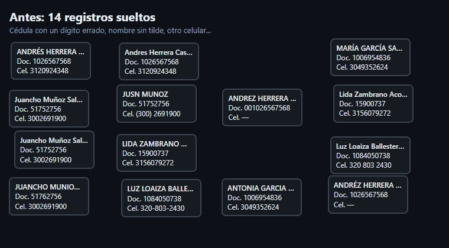

<div align="center">

# Resolución de identidades con Splink

**¿Cuáles registros de una base de clientes son la misma persona?** Un modelo probabilístico
que lo decide, explica cada decisión y se mide contra la verdad conocida, con pruebas ciegas
y una auditoría independiente.

[](https://github.com/stous1/identity-resolution/actions/workflows/ci.yml)
[](https://stous1.github.io/identity-resolution/)
[](.python-version)
[](LICENSE)

[](https://stous1.github.io/identity-resolution/hito3_universo.html)

<sub>Cada punto es un registro; los enlaces del modelo los agrupan en clientes. En morado,
datos de relleno; en verde, hogares; en rojo, patrones sospechosos.
[Abrir el universo interactivo →](https://stous1.github.io/identity-resolution/hito3_universo.html)</sub>

**[Probar la demo](https://stous1.github.io/identity-resolution/demo.html)** ·
**[Calculadora de impacto](https://stous1.github.io/identity-resolution/calculadora.html)** ·
**[Tableros](https://stous1.github.io/identity-resolution/)**

</div>

## En un minuto

**El problema.** En una base de clientes de un banco, la misma persona aparece varias veces:
la cédula con un dígito errado, el nombre sin tilde, "Pepe" en vez de "José", un teléfono
viejo, la dirección de antes de mudarse. Eso duplica comunicaciones, parte el historial y
esconde riesgos.

<p align="center"></p>

**Qué se construyó.** Un modelo Fellegi-Sunter con [Splink](https://moj-analytical-services.github.io/splink/)
sobre DuckDB, con estandarización colombiana, que une registros, construye un registro de
oro por cliente, detecta datos compartidos sospechosos y responde "¿ya es cliente?" en
tiempo real. Todo con datos sintéticos.

**Resultados vigentes** (modelos v3 y v4 congelados):

- **v1.1, realidad residencial colombiana** ([página](https://stous1.github.io/identity-resolution/v11.html)):
  parejas sin apellidos en común, convivientes, conjuntos y casas de varios pisos. En la
  **prueba ciega 4**, el modelo v4 sube el F1 de 0,987 (v3) a **0,994**, y el grafo
  residencial baja las personas inocentes marcadas como sospechosas de 36,7 % a **1,6 %**,
  aunque detecta menos patrones sospechosos (66,7 % de sus personas frente a 81,6 %).

- **Prueba ciega 3** (errores escritos por un generador independiente, nunca vistos):
  precisión **0,997** y recall **0,966** por clúster; 94,5 % de las personas reconstruidas
  exactamente.
- **Frente a reglas simples:** +0,065 de F1 sobre la mejor regla determinística en esa
  prueba. La ganancia está donde el documento falta o viene alterado.
- **1 millón de registros** en una sola máquina, en 129 s y con 7,1 GB de pico, con
  precisión 0,998 y recall 0,995.
- **"¿Ya es cliente?"** en unos 120 ms por consulta: precisión 0,999 si la mitad de las
  consultas son de clientes, y **0,938** si solo lo es el 1 %.
- **Auditoría independiente:** sin fugas de etiquetas y con todas las cifras reproducibles;
  sus hallazgos se corrigieron o matizaron en el [hito 6](https://stous1.github.io/identity-resolution/hito6.html).

## Qué se puede ver

| Enlace | Qué es |
|---|---|
| [Portada de los tableros](https://stous1.github.io/identity-resolution/) | Resumen navegable de todos los hitos en GitHub Pages |
| [Demo: ¿son la misma persona?](https://stous1.github.io/identity-resolution/demo.html) | Escribe dos registros y mira la probabilidad, la banda y la explicación, en el navegador |
| [Calculadora de impacto](https://stous1.github.io/identity-resolution/calculadora.html) | Las métricas del v3 convertidas en pesos al año, con supuestos editables |
| [Hito 1: fake_1000](https://stous1.github.io/identity-resolution/#hito-1-fake_1000) | El flujo completo sobre el dataset de demostración de Splink |
| [Hito 2: sintéticos colombianos](https://stous1.github.io/identity-resolution/hito2.html) | Estandarización, primera prueba ciega y FEBRL3 |
| [Hito 2b: corregir a ciegas](https://stous1.github.io/identity-resolution/hito2b.html) | Modelo v2 y segunda prueba ciega |
| [Hito 3: registro de oro y grafo](https://stous1.github.io/identity-resolution/hito3.html) | Supervivencia por campo, datos compartidos y puentes |
| [Hito 5: tiempo real y escala](https://stous1.github.io/identity-resolution/hito5.html) | "¿Ya es cliente?" y 1 millón de registros en DuckDB |
| [Hito 6: correcciones post-auditoría](https://stous1.github.io/identity-resolution/hito6.html) | Modelo v3, tercera prueba ciega, línea base y calibración |
| [v1.1: realidad residencial](https://stous1.github.io/identity-resolution/v11.html) | Modelo v4, grafo residencial y cuarta prueba ciega ([diagnóstico previo](https://stous1.github.io/identity-resolution/v11_diagnostico.html)) |
| [Universo residencial](https://stous1.github.io/identity-resolution/v11_universo.html) | Hogares, convivencia, multifamiliar, sospechosos, víctimas y suplantadores en Cosmograph |
| [Universo del hito 3](https://stous1.github.io/identity-resolution/hito3_universo.html) | 5 mil registros y sus enlaces en Cosmograph |
| [Universo grande](https://stous1.github.io/identity-resolution/hito5_universo.html) | 200 mil registros del conjunto de 1 millón, desde Parquet |
| [Informe de auditoría](audit/INFORME.md) | Auditoría independiente de los hitos 1 a 5 |
| [Verificación del hito 6](audit/verificacion_hito6.md) | Contraste de cifras y afirmaciones después de las correcciones |
| [Descripción del caso](docs/caso-01-identidades.md) | Objetivo, alcance y plan por hitos |
| [Informe técnico](INFORME_TECNICO.md) | Todo el detalle, hito por hito, con cifras e intervalos |

## Resultados

Por clúster (pares implicados por los clientes reconstruidos). La **prueba ciega** es la
cifra honesta: el modelo se congela antes de ver unos datos cuyos errores escribió otro
generador.

| Prueba | Modelo | Precisión | Recall | F1 Splink | F1 mejor regla |
|---|---|---|---|---|---|
| **Ciega 4** | **v4** | **0,995** | **0,993** | **0,994** | |
| Ciega 4 | v3 | 0,995 | 0,979 | 0,987 | |
| Ciega 3 | v3 | 0,997 | 0,966 | 0,981 | 0,916 |
| Ciega 3 | v2 | 0,994 | 0,978 | 0,985 | |
| Ciega 2 | v2 | 0,998 | 1,000 | 0,999 | 0,990 |
| Ciega 1 | v1 | 0,997 | 0,636 | 0,777 | 0,960 |
| FEBRL3 (público) | propio | 1,000 | 0,997 | 0,998 | 0,957 |
| fake_1000 (sin documento) | propio | 0,970 | 0,851 | 0,907 | 0,572 |
| 1 millón de registros | v3 | 0,998 | 0,995 | 0,997 | 0,924 |

<sub>"Mejor regla": "mismo documento o mismo nombre y fecha de nacimiento", con la misma
estandarización y unión transitiva (en fake_1000, correo en lugar de documento). Las filas
de las ciegas 1 y 2, FEBRL3 y fake_1000 salen de la [auditoría](audit/INFORME.md#2-línea-base-determinística-a2_linea_basepy);
las del v3, de [docs/resultados/hito6](docs/resultados/hito6/); las de la ciega 4, de
[docs/resultados/v11](docs/resultados/v11/). Intervalos de confianza
en el [informe técnico](INFORME_TECNICO.md).</sub>

En la ciega 3, el v3 a su umbral no supera al v2. Un diagnóstico muestra que la causa es
el umbral elegido en desarrollo: con el mismo umbral del v2, el v3 tendría más recall
(0,984).

## Rigor, historia y limitaciones

**Cómo se evalúa.** Toda decisión que mira la verdad (bloqueo, umbral, parámetros) se toma
en desarrollo; las métricas se miden una sola vez en prueba, con particiones por persona e
intervalos bootstrap. Cada modelo se congela con un tag de git y las pruebas verifican que
no cambió.

**Lo que salió mal y cómo se corrigió.**

1. La prueba normal del hito 2 daba recall 0,998; la **primera prueba ciega dio 0,636**.
2. Una **auditoría independiente** encontró la causa real: el modelo había aprendido
   "vetos" de hasta −48 bits (municipio distinto) porque el generador nunca mudaba a nadie.
   También mostró que la precisión caía a escala por reentrenar, que las probabilidades no
   estaban calibradas y que las cifras del hito 3 venían de una semilla favorable.
3. El **hito 6** corrigió eso: generador con mudanzas, un piso a los pesos negativos,
   escala con el modelo congelado, calibración, línea base y 8 semillas. Una **verificación
   posterior** encontró cifras mal atribuidas y conclusiones demasiado fuertes, y también
   se corrigieron.
4. En la **v1.1**, un diagnóstico mostró que el grafo marcaba como sospechosas a las
   parejas y tomaba por relleno toda dirección con apartamento. El grafo residencial lo
   corrige, pero en la ciega 4 se le escaparon anillos grandes: queda para una ciega 5.

**Limitaciones.**

- Todos los datos son **sintéticos** (Faker, más los datasets públicos de Splink y
  FEBRL), y **no hay validación con datos reales**.
- Los generadores de errores, incluidos los de las pruebas ciegas, los **escribieron
  agentes de IA**. "Independiente" quiere decir que no vieron el modelo, no que reproduzcan
  la realidad.
- Las ciegas 1 a 4 ya se miraron: la próxima corrección necesita una quinta.
- La distribución real de conjuntos, edificios y casas de varios pisos (cuántos clientes
  comparten un predio, cómo se escribe la unidad) **solo se puede calibrar con datos
  reales**.
- Los generadores que parten de `sinteticos` (prueba normal, ciegas 1 a 3, hito 3) cambian
  con la fecha del día; los de la v1.1 usan una fecha fija.
- El umbral elegido en desarrollo varía con la muestra, y la calibración no se transfiere a
  poblaciones nuevas.

<details>
<summary><b>Cómo correrlo</b></summary>

Requiere [uv](https://docs.astral.sh/uv/), que instala Python 3.11 si hace falta.

```bash
uv sync                                     # entorno y dependencias
uv run playwright install chromium          # una vez, para las capturas PNG
uv run pytest -m "not integracion"          # pruebas rápidas (sin internet)
uv run pytest                               # todas las pruebas
uv run ruff check . && uv run ruff format . # lint y formato

uv run python scripts/hito1_fake1000.py     # hito 1 -> reports/
uv run python scripts/hito2_colombia.py     # hito 2 -> reports/hito2/
uv run python scripts/validacion.py         # prueba ciega 1 y FEBRL3
uv run python scripts/hito2b.py evaluar     # v2 congelado en la ciega 2
uv run python scripts/hito3.py              # registro de oro, grafo y puentes
uv run python scripts/hito5.py tiempo-real  # "¿ya es cliente?"
uv run python scripts/hito6.py evaluar      # v3 congelado en la prueba normal y la ciega 3
uv run python scripts/hito6.py diagnostico-umbral  # v3 con el umbral del v2
uv run python scripts/hito6.py escala       # 100 mil y 1 millón (~8 GB de RAM)
uv run python scripts/v11.py evaluar        # v3 y v4 congelados y grafos en la ciega 4
uv run python scripts/servicio_local.py     # API local en http://127.0.0.1:8000/docs
uv run python scripts/gifs.py               # GIF del README (Playwright)
uv run python scripts/publicar_resultados.py --hito 6   # copia a docs/resultados/
```

La lista completa de comandos, con el desarrollo de cada modelo, está en
[CLAUDE.md](CLAUDE.md).

</details>

<details>
<summary><b>Estructura del repositorio</b></summary>

```
src/identidades/   toda la lógica, como funciones reutilizables con type hints
                   (generadores, estandarización, modelos v1-v4, evaluación, registro de
                   oro, grafo, tiempo real, escala, calibración y línea base)
scripts/           puntos de entrada delgados, uno por hito
tests/             pruebas con pytest (las lentas, marcadas como integración)
docs/              GitHub Pages: páginas por hito, universos de Cosmograph y resultados
docs/resultados/   tableros, PNG y JSON publicados (versionados)
audit/             auditoría independiente y verificaciones posteriores
INFORME_TECNICO.md detalle completo de cada hito
notebooks/         solo exploración
data/, reports/    datos y salidas de trabajo (no versionados)
```

</details>

<details>
<summary><b>Stack</b></summary>

- **Splink 4** sobre **DuckDB**: modelo Fellegi-Sunter, EM sin etiquetas y SQL compilado
  para tiempo real.
- **Python 3.11** con **uv**, **pandas** y **Faker** (es_CO) para los datos sintéticos.
- **Altair**, **vl-convert** y **Playwright** para gráficos y capturas.
- **Cosmograph** para los universos de registros (licencia CC-BY-NC-4.0, uso no comercial).
- **FastAPI** para el servicio local, **pytest**, **ruff** y GitHub Actions.

</details>

## Lo que viene

- **Hito 4: agente de revisión.** Un agente que revise la zona gris (pares entre 5,2 y
  19,9 bits) y la [cola de revisión](docs/resultados/hito3/cola_revision.csv) del hito 3,
  con la explicación por campo como evidencia.
- **Quinta prueba ciega** para cualquier corrección nueva (la primera: que el grafo no
  tome por relleno un anillo grande), **umbral estable** por
  remuestreo del desarrollo, un **híbrido solo con "mismo documento"** y un **escenario
  ciego** para los patrones sospechosos. Lista completa en el
  [informe técnico](INFORME_TECNICO.md#trabajo-futuro).

---

<sub>Regla dura del proyecto: nunca datos reales de clientes ni código o ideas de proyectos
internos de ningún banco. Solo datasets públicos de demostración y sintéticos.</sub>
