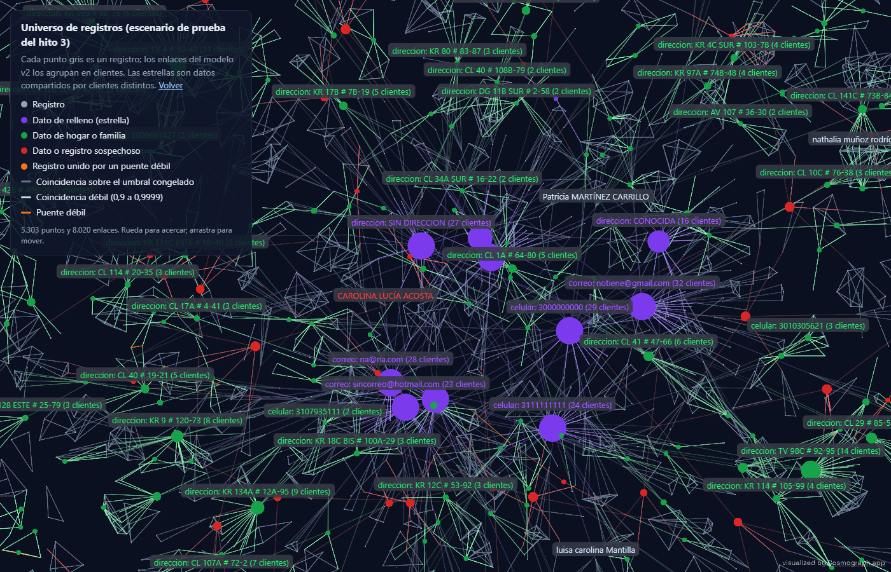

# Resolución de identidades con Splink

[](https://github.com/stous1/identity-resolution/actions/workflows/ci.yml)

Caso de uso 1 de un portafolio de ciencia de datos y agentes aplicado a banca: **calidad del
dato y resolución de identidades**.

**Tableros interactivos:** [stous1.github.io/identity-resolution](https://stous1.github.io/identity-resolution/)

| Hito | Datos | Resultado principal (prueba) |
|---|---|---|
| [1. fake_1000](#hito-1-fake_1000-de-punta-a-punta) | Demo de Splink, 251 personas | Precisión 0,970 y recall 0,851 por clúster |
| [2. Colombia](#hito-2-clientes-sintéticos-colombianos-y-estandarización) | Sintéticos es_CO, 2.000 personas | Prueba normal: precisión 1,000 y recall 0,998 por clúster. **[Prueba ciega](#validación-prueba-ciega-y-febrl3): precisión 0,997 y recall 0,636** |
| [2b. Corrección](#hito-2b-corregir-y-volver-a-medir-a-ciegas) | Ciega 1 como desarrollo; ciega 2 nueva | **Ciega 2: precisión 0,998 y recall 1,000 por clúster** (v1 en la misma ciega 2: 0,995 y 0,920) |
| [3. Registro de oro y grafo](#hito-3-registro-de-oro-grafo-de-identidad-compartida-y-puentes) | Escenario con historia, metadatos y patrones sospechosos | Registro de oro a menos de 5 puntos del techo alcanzable; 432 grupos compartidos bien clasificados; puentes que evitan 4 de cada 10 mezclas sin perder recall |

## Qué problema resuelve

En una base de clientes, la misma persona aparece varias veces con pequeñas diferencias: un
dígito errado en el documento, un nombre sin tilde, un teléfono viejo. Eso infla el número de
clientes, duplica comunicaciones y esconde relaciones de riesgo.

Este proyecto detecta qué registros corresponden al mismo cliente con un modelo probabilístico
Fellegi-Sunter (con [Splink](https://github.com/moj-analytical-services/splink) sobre DuckDB),
**entrenado sin etiquetas**, explica cada decisión campo por campo y mide su precisión contra
la verdad conocida.

Descripción completa del caso: [docs/caso-01-identidades.md](docs/caso-01-identidades.md).

## Hito 1: fake_1000 de punta a punta

Dataset de demostración de Splink: 1.000 registros de 251 personas, con errores de digitación,
campos vacíos y variaciones de nombres. La columna `cluster` (quién es quién) solo se usa para
elegir reglas y umbral en desarrollo y para evaluar.

**Modelo**

- Comparaciones: nombre y apellido (Jaro-Winkler con ajuste por frecuencia), fecha de
  nacimiento (niveles por distancia), ciudad (exacta con ajuste por frecuencia) y correo.
- Entrenamiento sin etiquetas: λ con reglas determinísticas, *u* por muestreo aleatorio y *m*
  con EM en dos pasadas (bloqueo por nombre+apellido y por fecha de nacimiento).
- Bloqueo: 4 reglas exactas (nombre, apellido, fecha de nacimiento, correo) más las reglas
  aproximadas que se eligen en desarrollo (ver abajo).

### Cómo se evalúa

Elegir reglas y umbral mirando la verdad conocida y medir sobre los mismos datos da métricas
optimistas. Por eso:

1. **Partición por persona.** Las 251 personas se dividen al azar (semilla 42) en
   **desarrollo** (60 %: 151 personas, 608 registros) y **prueba** (40 %: 100 personas, 392
   registros). Todos los registros de una persona quedan del mismo lado.
2. **Desarrollo.** Solo aquí se mira la verdad conocida: se eligen las reglas de bloqueo, se
   entrena el modelo y se elige el umbral por costo.
3. **Prueba.** El modelo de desarrollo se aplica a prueba, deduplicando dentro de prueba. Los
   parámetros *m* y *u* vienen de desarrollo; λ (la probabilidad a priori de que dos registros
   al azar sean la misma persona) depende del tamaño del conjunto, así que se vuelve a estimar
   en prueba con las mismas reglas determinísticas, que no usan etiquetas (0,0055 en
   desarrollo, 0,0082 en prueba).
4. **Medición única.** Las métricas de prueba se calculan una sola vez, con intervalos de
   confianza del 95 % por bootstrap: 1.000 réplicas remuestreando personas con reemplazo,
   porque prueba tiene solo 100 personas.

### Resultados en prueba

Umbral 0,83, elegido en desarrollo. Entre corchetes, el intervalo de confianza del 95 %.

| Nivel | Precisión | Recall | F1 |
|---|---|---|---|
| Por par | 0,998 [0,991 – 1,000] | 0,709 [0,649 – 0,761] | 0,829 [0,786 – 0,864] |
| Por clúster (pares inducidos) | 0,970 [0,864 – 1,000] | 0,851 [0,790 – 0,903] | 0,907 [0,845 – 0,946] |

- **Personas reconstruidas exactamente:** 73 de 100 (73 % [64 % – 81 %]); 129 clústeres
  predichos frente a 100 personas.
- **Recall del bloqueo:** 90,8 % de los 808 pares verdaderos de prueba llegan a compararse
  (1.262 comparaciones).
- **Aparecen uniones erróneas que desarrollo no mostraba.** Un solo par falso por encima del
  umbral une dos clústeres y deja 21 pares de registros juntos por error. Es el efecto
  transitivo que motivó elegir el umbral por clúster, y es la captura de Cluster Studio de
  abajo. El intervalo de precisión por clúster (0,864 – 1,000) refleja que con 100 personas un
  solo error así pesa mucho.

Métricas completas: [docs/resultados/metricas.json](docs/resultados/metricas.json).

### Desarrollo, prueba y referencia

| Conjunto | Umbral | Precisión por clúster | Recall por clúster | Personas exactas |
|---|---|---|---|---|
| **Prueba (métrica principal)** | 0,83 | **0,970** | **0,851** | **73 %** |
| Desarrollo (donde se eligió todo) | 0,83 | 1,000 | 0,930 | 84 % |
| Todo el dataset (solo referencia, optimista) | 0,84 | 1,000 | 0,903 | 81 % |

La fila de referencia repite el mismo procedimiento (selección de bloqueo, entrenamiento y
umbral) sobre las 251 personas y mide sobre esas mismas personas, así que **es optimista**: no
hay datos que el procedimiento no haya visto. Desarrollo también lo es, por la misma razón. La
diferencia con prueba (recall por clúster 0,93 → 0,85 y la primera unión errónea) es el tamaño
de ese optimismo.

> **Historia del hito.** En la primera versión de este hito, las 10 reglas de bloqueo y el
> umbral de 0,84 se eligieron mirando todo el dataset, y sus métricas (precisión 1,000 y
> recall 0,904 por clúster, 81,7 % de personas exactas) se midieron sobre los mismos datos.
> Eran optimistas. Hoy la selección es automática y usa solo desarrollo; la versión anterior
> queda en el historial de git.

### Bloqueo aproximado (elegido en desarrollo)

Con solo reglas exactas, el 18,6 % de los pares verdaderos de desarrollo nunca se compara
porque no comparte ningún campo idéntico (por ejemplo, un apellido mal escrito y una fecha con
un dígito cambiado, con el correo vacío). Hay 8 reglas aproximadas candidatas: Soundex y
Metaphone del apellido, Metaphone y primeras 3 letras del nombre (fonética con
[jellyfish](https://github.com/jamesturk/jellyfish)), año de nacimiento + inicial del apellido
o del nombre, primeros 4 caracteres del correo, y ciudad + año de nacimiento.

La selección es voraz: en cada paso se agrega la candidata que más pares verdaderos nuevos
cubre en desarrollo, y se para cuando la mejor suma menos de 0,5 puntos de recall del bloqueo
([seleccion_bloqueos.csv](docs/resultados/seleccion_bloqueos.csv)):

| Paso | Regla agregada | Comparaciones | Recall del bloqueo |
|---|---|---|---|
| 0 | Exactas | 1.771 | 0,814 |
| 1 | Primeros 4 caracteres del correo | 2.028 | 0,883 |
| 2 | Soundex del apellido | 2.436 | 0,907 |
| 3 | Ciudad + año de nacimiento | 2.544 | 0,917 |

Con las 12 reglas el recall del bloqueo en desarrollo llega a 0,930, pero con 3.547
comparaciones y el mismo recall por clúster (0,930). La medición con el modelo entrenado
para cada combinación está en
[comparacion_bloqueos.csv](docs/resultados/comparacion_bloqueos.csv); ninguna bajó la
precisión en desarrollo.

### Umbral por costo (elegido en desarrollo)

Elegir el umbral es una decisión de negocio. En banca, **unir por error a dos clientes
distintos** (falso positivo) mezcla sus productos, datos de contacto y riesgo, y es mucho más
grave que **dejar un duplicado sin unir** (falso negativo), que se puede corregir después. Por
eso se asigna un costo de 10 a cada falso positivo y de 1 a cada falso negativo (ambos
configurables con `--costo-fp` y `--costo-fn`) y se busca, en desarrollo, el umbral que
minimiza `10 × FP + 1 × FN`.

| Criterio (en desarrollo) | Umbral | Precisión por clúster | Recall por clúster | Costo por clúster |
|---|---|---|---|---|
| Fijo | 0,90 | 1,000 | 0,902 | 120 |
| Mejor F1 por par | 0,11 | 0,724 | 0,975 | 4.571 |
| Menor costo por par | 0,82 | 1,000 | 0,930 | 86 |
| **Menor costo por clúster (en uso)** | **0,83** | **1,000** | **0,930** | **86** |

**Se usa el de menor costo por clúster** porque la decisión que de verdad une clientes es el
clúster, no el par. La agrupación es transitiva: si A se parece a B y B a C, A y C quedan
juntos aunque no se parezcan, así que unos pocos falsos positivos por par se multiplican al
agrupar (con el de mejor F1 por par, 454 pares de registros quedan juntos por error). En este
desarrollo los umbrales de menor costo por par y por clúster casi coinciden; cuando hay
empate en costo se elige el umbral más alto, que es el más conservador.


### Cascada por par (prueba)

Cómo cada campo suma o resta evidencia para un par. El tablero interactivo incluye ejemplos de
acierto, falso positivo y falso negativo en prueba.


### Cluster Studio (prueba)

Grafo de cada clúster predicho en prueba, con sus registros y pares puntuados, priorizando los
que tienen errores. La captura muestra el clúster que mezcla dos personas: los 7 registros
109–115 y los 3 registros 843–845 quedan juntos por un solo par por encima del umbral
(109–844, probabilidad 0,851 frente al umbral de 0,83), lo que
induce los 7 × 3 = 21 pares falsos. Los enlaces en rojo son pares con baja probabilidad que el
tablero también dibuja.


### Tableros publicados

Cascada, Cluster Studio y comparison viewer son de prueba; parámetros, pesos y curvas son del
modelo y la selección hechos en desarrollo.

- [Cascada por par](https://stous1.github.io/identity-resolution/resultados/cascada.html)
- [Cluster Studio](https://stous1.github.io/identity-resolution/resultados/cluster_studio.html)
- [Comparison viewer](https://stous1.github.io/identity-resolution/resultados/comparison_viewer.html)
- [Parámetros m/u](https://stous1.github.io/identity-resolution/resultados/parametros_mu.html)
  y [pesos de coincidencia](https://stous1.github.io/identity-resolution/resultados/pesos.html)
- Curvas por umbral: [por par](https://stous1.github.io/identity-resolution/resultados/curva_umbral.html),
  [por clúster](https://stous1.github.io/identity-resolution/resultados/curva_umbral_clusters.html)
  y [costo](https://stous1.github.io/identity-resolution/resultados/costo_umbral.html)

## Hito 2: clientes sintéticos colombianos y estandarización

**Tableros:** [stous1.github.io/identity-resolution/hito2.html](https://stous1.github.io/identity-resolution/hito2.html)

### Datos sintéticos

`identidades.sinteticos` genera, con Faker `es_CO` y semilla fija, 2.000 personas y 4.851
registros ([muestra](docs/resultados/hito2/muestra_registros.csv)):

- **Personas:** CC o CE, nombres simples y compuestos (40 %), dos apellidos (85 %) o uno,
  fecha de nacimiento, celular de 10 dígitos que empieza por 3, correo, dirección colombiana
  ("Cra 45 # 10-20", "Calle 10 Sur # 43A-15") y ciudad con su departamento.
- **Registros:** de 1 a 6 por persona, con errores a tasas configurables (`TasasError`):
  dígitos transpuestos, faltantes o errados en el documento, documento con puntos o vacío,
  errores de digitación, tildes quitadas o puestas, nombres en otro orden, segundo apellido
  omitido, otras abreviaturas de dirección (Cra, Carrera, KR, Cl, Calle, No., N°), celular en
  otro formato, teléfono o correo cambiados con el tiempo, y fechas con día y mes
  intercambiados.
- **Familiares:** una cuarta parte de las personas son hermanos o padres e hijos de otra.
  Comparten apellidos y dirección, y a veces el teléfono: es la fuente típica de falsos
  positivos.
- **Relleno compartido** por personas distintas, para el hito 3: teléfonos como 3000000000,
  correos genéricos (notiene@gmail.com) y direcciones vagas ("CENTRO").
- La columna `cluster` es la verdad (el id de la persona).

### Estandarización

`identidades.estandarizacion`, con una prueba por regla:

- **Nombres y apellidos:** mayúsculas, columna auxiliar sin tildes (la Ñ pasa a N), y
  separación de compuestos respetando partículas ("MARÍA DE LOS ÁNGELES", "DE LA HOZ").
- **Documento:** solo dígitos. **Celular:** 10 dígitos que empiezan por 3, sin el
  indicativo 57. **Correo:** minúsculas y validación.
- **Dirección:** tipo de vía, número, cuadrante, placa y consecutivo, con forma canónica:
  "Cra 45 No. 10 - 20" y "KR 45 10 20" quedan "KR 45 # 10-20".

### Modelo

El mismo esquema de evaluación del hito 1: bloqueo y umbral elegidos en desarrollo (1.200
personas, 2.920 registros) y métricas en prueba (800 personas, 1.931 registros) con
intervalos del 95 % por bootstrap de personas. Comparaciones:

- **Documento por niveles:** exacto, un dígito distinto, dos dígitos transpuestos, un dígito
  de más o de menos.
- **Nombres:** iguales, los mismos en otro orden, mismo primer nombre o parecidos.
- **Primer y segundo apellido** (Jaro-Winkler), fecha de nacimiento, celular, correo,
  dirección (igual, misma vía, número y placa, o parecida) y ciudad. Celular, correo y
  dirección llevan ajuste por frecuencia, que le baja el peso a los datos de relleno.

Para medir cuánto aporta la estandarización se entrena **el mismo modelo** dos veces: con
los datos estandarizados y con los textos tal cual (solo partidos por espacios). Cada
variante elige su bloqueo y su umbral en desarrollo.

### Resultados en prueba

| Variante | Umbral | Precisión por clúster | Recall por clúster | Personas exactas | Recall por par |
|---|---|---|---|---|---|
| **Estandarizado** | 0,999999 | **1,000** [1,000 – 1,000] | **0,998** [0,993 – 1,000] | **99,8 %** [99,4 – 100] | 0,994 [0,989 – 0,998] |
| Sin estandarizar | 0,98 | 0,989 [0,960 – 1,000] | 0,983 [0,975 – 0,990] | 96,1 % [94,8 – 97,4] | 0,907 [0,893 – 0,921] |

**Aporte de la estandarización** (diferencia pareada en prueba, estandarizado − sin
estandarizar):

| Métrica | Diferencia | IC 95 % | ¿Significativa? |
|---|---|---|---|
| Recall por clúster | +0,015 | [+0,006, +0,024] | Sí |
| Personas exactas | +3,6 puntos | [+2,4, +5,0] | Sí |
| Recall por par | +0,087 | [+0,073, +0,102] | Sí |
| Precisión por clúster | +0,011 | [0,000, +0,040] | No |

Sin estandarizar, el bloqueo exacto solo cubre el 82 % de los pares verdaderos en desarrollo
(frente al 99 % estandarizado), porque "1.023.456" y "1023456", o "+57 300…" y "300…", ya
no coinciden. Además, 24 pares de registros de personas distintas quedan unidos por error.


### Equidad

Precisión, recall y personas reconstruidas exactamente en prueba, por clúster, según
atributos verdaderos de la persona. Las diferencias son pareadas (mismas réplicas del
bootstrap) y se consideran significativas si su intervalo no incluye el cero.

| Grupo (personas en prueba) | Recall, estandarizado | Exactas, estandarizado | Recall, sin estandarizar | Exactas, sin estandarizar |
|---|---|---|---|---|
| Nombre simple (457) | 0,999 | 99,8 % | 0,986 | 96,9 % |
| Nombre compuesto (343) | 0,996 | 99,7 % | 0,979 | 95,0 % |
| Dos apellidos (667) | 0,997 | 99,7 % | 0,982 | 96,1 % |
| Un apellido (133) | 1,000 | 100 % | 0,987 | 96,2 % |
| Con tilde o ñ (548) | 0,997 | 99,8 % | 0,985 | 96,5 % |
| Sin tilde (252) | 0,999 | 99,6 % | 0,981 | 95,2 % |

- **Con estandarización, el modelo no falla más con ningún grupo:** ninguna diferencia es
  significativa y la precisión es 1,000 en todos.
- **Sin estandarizar,** las personas con nombre compuesto quedan reconstruidas exactamente
  un poco menos (95,0 % frente a 96,9 %), pero la diferencia no es significativa
  (+1,9 puntos, IC [−0,8, +4,7]). Tampoco lo son las demás.
- Ojo: el generador aplica las mismas tasas de error a todos, así que los grupos solo
  difieren en la estructura del nombre. Con datos reales, donde la calidad de captura
  puede variar entre poblaciones, este análisis es más necesario.


### Casos difíciles: familiares con el mismo nombre

Los errores que quedan vienen de familiares que viven juntos. En prueba, el par más difícil
son dos hermanas que se llaman igual (MARÍA ZAPATA ROMERO, nacidas en 1975 y 2006): misma
dirección (factor ×647), mismo nombre (×263) y mismos apellidos superan la evidencia en
contra del documento y la fecha, y el par queda con peso 18,0 (probabilidad 0,999996), justo
por debajo del umbral. La suposición de independencia entre campos de Fellegi-Sunter no se
cumple dentro de un hogar. En desarrollo, el umbral de menor costo deja todavía 4 pares de
ese tipo. Son los casos para el agente de la zona gris (hito 4).

### Limitaciones

- Los datos son sintéticos y el generador y la estandarización los escribió la misma
  persona: la estandarización conoce los errores que se inyectaron. Las métricas son una
  cota optimista; la cifra honesta es la de la
  [prueba ciega](#validación-prueba-ciega-y-febrl3).
- El bloqueo elegido en desarrollo para la variante estandarizada agrega solo
  `domicilio_clave` (vía, número y placa) a las reglas exactas.
- [Comparación de bloqueos](docs/resultados/hito2/comparacion_bloqueos.csv) y
  [selección](docs/resultados/hito2/seleccion_bloqueos.csv) en desarrollo.

### Validación: prueba ciega y FEBRL3

Las métricas del hito 2 tienen un problema de circularidad: el generador de errores y la
estandarización los escribió la misma persona, así que la estandarización ya "conoce" los
errores que va a ver. Para tener una cifra honesta:

1. **Se congeló el modelo** (estandarización, esquema y parámetros entrenados) en el tag
   `hito2-congelado`, con su umbral de 0,999999.
2. **Un subagente que no leyó la estandarización ni el modelo** escribió un generador de
   errores nuevo ([`errores_ciegos.py`](src/identidades/errores_ciegos.py)) con errores no
   contemplados: más tipos y abreviaturas de vía (Ak, Ac, Avda, Transv., Km), direcciones
   rurales (veredas, fincas, corregimientos), apodos (Pepe, Pacho, Chucho, Mafe...), errores
   de lectura de documentos (O por 0, l por 1, S por 5, B por 8), espacios y puntuación
   irregulares, fechas en otros formatos ("07 de marzo de 1985", 07-MAR-1985), apellido de
   casada ("Figueroa de Ortiz"), campos cruzados, fijos de 7 dígitos, dominios de correo mal
   escritos, ciudades abreviadas (Bta, B/quilla) y texto mal codificado ("José").
3. **El modelo congelado se aplicó sin ajustar nada** a 2.000 personas nuevas (6.032
   registros, otra semilla). Solo se vuelve a estimar λ, como en cualquier lote nuevo, con
   reglas que no usan etiquetas.
4. **Validación externa:** el mismo procedimiento del hito 2 (bloqueo y umbral elegidos en
   desarrollo, métricas en prueba) sobre FEBRL3, un generador de registros con errores
   ajeno a este proyecto (5.000 registros de 2.000 personas).

**Las tres cifras** (por clúster, en prueba, IC 95 % por bootstrap de personas):

| Evaluación | Precisión | Recall | F1 | Personas exactas |
|---|---|---|---|---|
| Prueba normal del hito 2 (800 personas) | 1,000 [1,000 – 1,000] | 0,998 [0,993 – 1,000] | 0,999 [0,997 – 1,000] | 99,8 % [99,4 – 100] |
| **Prueba ciega (2.000 personas)** | **0,997** [0,987 – 1,000] | **0,636** [0,616 – 0,657] | **0,777** [0,762 – 0,792] | **60,2 %** [58,1 – 62,3] |
| FEBRL3 (800 personas) | 1,000 [1,000 – 1,000] | 0,997 [0,992 – 1,000] | 0,998 [0,996 – 1,000] | 99,6 % [99,1 – 100] |


**Por qué la prueba ciega es la cifra más honesta.** En la prueba normal, la separación
desarrollo/prueba evita que el modelo vea a las mismas personas, pero no evita que el
diseño (qué normalizar, qué comparaciones usar) se haya hecho a la medida de los errores
del generador: ambos salieron de la misma cabeza. FEBRL es externo, pero el procedimiento
se ajustó a FEBRL (bloqueo, entrenamiento y umbral sobre sus datos), y sus errores son
sencillos (digitación y valores faltantes sobre campos bien separados). La prueba ciega es
la única donde ni el diseño ni los parámetros pudieron adaptarse a los datos evaluados, que
es lo que le pasa a un modelo en producción cuando llega un canal o un sistema nuevo.

**Lo que muestra:**

- **La precisión aguanta:** 0,997. El modelo casi nunca une personas distintas, que en
  banca es el error caro.
- **El recall se cae:** de 0,998 a 0,636. Una de cada tres duplicaciones queda sin unir, y
  solo el 60 % de las personas queda reconstruida exactamente (3.128 clústeres para 2.000
  personas).
- **No es solo el umbral:** a umbral 0,5 el recall sube a 0,807, pero la precisión cae a
  0,803. Los puntajes ya no separan bien; la solución es mejorar la estandarización y las
  comparaciones, no mover el umbral. Este diagnóstico no se usa para la cifra principal:
  elegir otro umbral mirando estos datos sería ajustar el modelo.
- **Dónde falla** (personas reconstruidas exactamente, diagnóstico por tipo de error):
  nombres en otro campo 29,7 % (frente a 62,8 %), documento alterado 45,4 % (frente a
  63,4 %) y celular cambiado por un fijo 49,1 % (frente a 61,5 %). Todas las diferencias
  son significativas.
- **Primer hallazgo:** con el tag original, el modelo **se caía** con 66 registros sin
  apellidos (pandas convierte el `None` en `NaN` y la estandarización no lo esperaba). Se
  corrigió la robustez sin cambiar ningún resultado del hito 2 (métricas idénticas) y se
  congeló de nuevo como `hito2-congelado-r1`. La validación verifica contra ese tag.

**Equidad en la prueba ciega** (personas reconstruidas exactamente, por clúster):

| Grupo | Exactas | Frente a | Diferencia | ¿Significativa? |
|---|---|---|---|---|
| Apellido de casada (136) | 41,2 % | 61,5 % sin él | −20,4 puntos [−29,1, −11,4] | **Sí** |
| Con apodo (337) | 49,3 % | 62,4 % sin apodo | −13,1 puntos [−19,0, −7,4] | **Sí** |
| Nombre compuesto (788) | 61,8 % | 59,1 % simple | +2,7 [−1,3, +7,1] | No |
| Un apellido (301) | 59,1 % | 60,3 % con dos | −1,2 [−7,0, +4,5] | No |
| Sin tilde (634) | 59,6 % | 60,4 % con tilde | −0,8 [−5,6, +3,9] | No |
| Dirección rural (135) | 59,3 % | 60,2 % urbana | −1,0 [−9,9, +7,5] | No |

El hallazgo de equidad más importante: **el modelo falla más con mujeres que usan apellido
de casada**. La estandarización separa "Ramírez de Vargas" en primer apellido RAMIREZ y
segundo apellido DE VARGAS, que choca con el segundo apellido verdadero (OSORIO): el campo
resta evidencia en vez de quedar neutral, y esos registros quedan sin unir. Con los apodos
pasa algo parecido: "Pepe" no se reconoce como "José". La prueba normal no lo podía mostrar, porque su
generador no producía esos casos. La precisión no difiere entre grupos.


Métricas completas en
[docs/resultados/validacion/metricas.json](docs/resultados/validacion/metricas.json) y una
[muestra de registros ciegos](docs/resultados/validacion/ciega_muestra_registros.csv).

## Hito 2b: corregir y volver a medir a ciegas

La prueba ciega 1 dejó de ser ciega en cuanto se vieron sus errores, así que pasó a ser
**desarrollo**. Con ella se corrigió el modelo, se congeló de nuevo y se midió con una
**prueba ciega 2** que nadie había visto.

**Correcciones** ([`estandarizacion_v2.py`](src/identidades/estandarizacion_v2.py) y
[`modelo_co_v2.py`](src/identidades/modelo_co_v2.py); la versión 1 no se modifica, para que
sus cifras sigan siendo reproducibles), en orden de impacto:

1. **Apellido de casada:** "Arango de Ramírez" se separa en apellido ARANGO y apellido de
   casada RAMIREZ, que es una comparación propia. Si un registro lo tiene y el otro no, es
   neutral; ya no choca con el segundo apellido.
2. **Apodos:** un diccionario de 133 apodos y 23 formas abreviadas colombianas (Pepe,
   Pacho, Toño, Betty, Mafe, Juanda...) que pasan a su nombre formal.
3. **Nombres en otro campo:** niveles para nombre y apellido intercambiados, y para "el
   primer nombre de uno y otra palabra aparecen en cualquier campo de nombre del otro". La
   primera versión de este nivel (dos palabras en común) unía hermanos, que comparten los
   dos apellidos, y se endureció en desarrollo.
4. **Documento:** corrección de errores de lectura (O por 0, l por 1...) y un nivel de
   hasta dos ediciones.
5. **Teléfonos:** cualquier teléfono contra cualquier teléfono. Si uno de los dos solo tiene
   un fijo, el nivel es aparte y no cuenta como teléfonos distintos. Los números que
   aparecen en más registros de los que puede tener una persona (relleno) se ignoran.
6. **Extras,** fuera de la lista original: fechas en otros formatos ("20 de octubre de
   1999", "12/10/88", "09-ABR-1998") normalizadas a ISO, que antes perdían la evidencia de
   la fecha, y texto mal codificado ("Ramírez").

**Desarrollo:** el del hito 2 (1.200 personas) más toda la ciega 1 (2.000 personas). Ahí se
eligieron el bloqueo y el umbral (0,9999), y el modelo se congeló en el tag
`hito2b-congelado`. Después, **un subagente nuevo**, sin acceso a la estandarización (v1 ni
v2), los esquemas, los generadores anteriores ni sus resultados, escribió el
[generador de la ciega 2](src/identidades/errores_ciegos_2.py): 2.000 personas nuevas, otra
semilla, su propio diccionario de apodos y sus propias formas de apellido de casada, y 17
tipos de error nuevos (grafías como Brayan, Jhon o Leidy; "María del Carmen"; iniciales;
títulos; apellidos con guion; dígito de verificación; tarjeta de identidad antigua;
pasaporte o PPT en vez de cédula de extranjería; correo corporativo; vías con nombre
propio; dirección anterior; año de dos dígitos...).

### Evolución (por clúster, IC 95 % por bootstrap de personas)

| Evaluación | Precisión | Recall | Personas exactas |
|---|---|---|---|
| Prueba normal · modelo v1 | 1,000 [1,000 – 1,000] | 0,998 [0,993 – 1,000] | 99,8 % |
| Prueba normal · modelo v2 | 1,000 [1,000 – 1,000] | 0,993 [0,986 – 0,999] | 99,5 % |
| Ciega 1 · modelo v1 | 0,997 [0,987 – 1,000] | 0,636 [0,616 – 0,657] | 60,2 % |
| Ciega 1 · modelo v2 (*es desarrollo: optimista*) | 1,000 | 1,000 | 100 % |
| Ciega 2 · modelo v1 (control) | 0,995 [0,977 – 1,000] | 0,920 [0,907 – 0,932] | 91,1 % |
| **Ciega 2 · modelo v2** | **0,998** [0,994 – 1,000] | **1,000** [1,000 – 1,000] | **99,7 %** [99,5 – 99,9] |


**Cómo leer esta tabla.** La ciega 2 resultó **más fácil** que la ciega 1: el mismo modelo
v1, que en la ciega 1 tenía recall 0,636, en la ciega 2 llega a 0,920. Comparar "ciega 1 con
v1" contra "ciega 2 con v2" mezclaría la mejora del modelo con la diferencia entre
generadores. Por eso se aplicó también el modelo v1 congelado a la ciega 2 como control. La
comparación justa es sobre las mismas personas de la ciega 2 (diferencia pareada v2 − v1):

| Métrica (por clúster) | v2 − v1 en la ciega 2 | IC 95 % | ¿Significativa? |
|---|---|---|---|
| Recall | +0,080 | [+0,068, +0,093] | Sí |
| Personas exactas | +8,6 puntos | [+7,4, +9,8] | Sí |
| Precisión | +0,004 | [−0,003, +0,021] | No |

- **El modelo v2 mejora a ciegas:** recuperó todos los pares verdaderos de la ciega 2 sin
  perder precisión. Quedan 3 uniones erróneas (1.997 clústeres para 2.000 personas).
- **En la prueba normal empeora un poco:** el recall baja de 0,998 a 0,993 (15 pares
  faltantes en vez de 5). Los intervalos se solapan; es el costo de los niveles más
  tolerantes.

### Brecha de equidad: antes y después

Personas reconstruidas exactamente, por grupo:

| Grupo | Antes (ciega 1, v1) | Control (ciega 2, v1) | Después (ciega 2, v2) |
|---|---|---|---|
| Con apellido de casada | 41,2 % | 92,0 % | 100 % |
| Sin apellido de casada | 61,5 % | 91,0 % | 99,7 % |
| **Brecha** | **−20,4 puntos [−29,1, −11,4]** | +1,0 [−2,5, +4,4] | +0,3 [+0,1, +0,6] |
| Con apodo | 49,3 % | 90,8 % | 100 % |
| Sin apodo | 62,4 % | 91,1 % | 99,7 % |
| **Brecha** | **−13,1 puntos [−19,0, −7,4]** | −0,3 [−4,5, +3,8] | +0,3 [+0,1, +0,6] |

**¿Se cerró la brecha?** En la ciega 2 no hay brecha en contra de las mujeres con apellido
de casada ni de las personas con apodo: con v2 quedan reconstruidas al 100 %, y el
"+0,3 puntos" a su favor no tiene peso práctico (sale de las 3 uniones erróneas, que cayeron
en personas de los otros grupos). Pero hay que ser honesto con lo que esto demuestra:

- **Con el control no aparece brecha tampoco con v1** (92,0 % frente a 91,0 %). Las formas de
  apellido de casada y los apodos del generador de la ciega 2 perjudican menos que los de la
  ciega 1, así que la ciega 2 no puede confirmar por sí sola que la corrección cerró la
  brecha que se vio en la ciega 1.
- **Lo que sí se puede afirmar:** la corrección elimina la brecha en los casos de la ciega 1
  (en desarrollo, optimista), y en datos que el modelo nunca vio no aparece ninguna brecha
  nueva. Para confirmar a ciegas la corrección del caso difícil haría falta una tercera
  prueba que incluya, a propósito, el apellido de casada en la posición del segundo apellido.


Métricas completas en [docs/resultados/hito2b/metricas.json](docs/resultados/hito2b/metricas.json)
y [muestra de registros de la ciega 2](docs/resultados/hito2b/ciega2_muestra_registros.csv).

## Hito 3: registro de oro, grafo de identidad compartida y puentes

**Visualización:** [universo de registros en Cosmograph](https://stous1.github.io/identity-resolution/hito3_universo.html)



### Escenario

El generador del hito 2 no tiene historia en el tiempo ni datos sospechosos, y cambiarlo
alteraría los hitos anteriores. Por eso se creó un escenario aparte
([`escenario_hito3.py`](src/identidades/escenario_hito3.py)) sobre las mismas personas
sintéticas:

- **Historia:** el celular, el correo y el domicilio pueden cambiar en una fecha. El valor
  vigente (el último) es la verdad del registro de oro.
- **Metadatos por registro:** fecha de actualización, canal de origen (sucursal, app, web,
  call center, corresponsal) y si el dato fue validado. Los canales menos confiables y los
  datos sin validar tienen más errores.
- **Datos compartidos con verdad conocida:** relleno (3000000000, notiene@gmail.com,
  "CENTRO"), hogares (familiares con la misma dirección y a veces el mismo teléfono) y
  patrones sospechosos: anillos de 3 a 6 personas no relacionadas que en registros
  recientes, por canales digitales y sin validar, comparten un celular, un correo o una
  dirección; y suplantaciones (un registro con el documento de otra persona).

**Regla de evaluación:** todo lo que se elige (regla de supervivencia, umbrales del
clasificador, política de puentes) se elige en un escenario de **desarrollo** (semilla 3030)
y se mide una sola vez en otro de **prueba** (semilla 3131, 2.000 personas, 4.839
registros). Los clientes salen del modelo v2 congelado, sin ajustes (en prueba: precisión
1,000 y recall 0,998 por clúster).

### Registro de oro

Para cada cliente y cada campo sobrevive un valor según una regla: el **más reciente**, el
**validado** más reciente, el de la **fuente más confiable** o el **más frecuente**. Los
valores que el grafo clasifica como relleno no pueden sobrevivir. La regla de cada campo se
eligió en desarrollo:

| Campo | Regla (elegida en desarrollo) | Acierto en prueba (IC 95 %) | Techo alcanzable |
|---|---|---|---|
| Documento | Fuente más confiable | 95,6 % [94,7 – 96,5] | 97,2 % |
| Nombres | Fuente más confiable | 92,8 % [91,6 – 94,0] | 96,1 % |
| Apellidos | Fuente más confiable | 93,6 % [92,5 – 94,6] | 96,6 % |
| Fecha de nacimiento | Más reciente | 100 % | 100 % |
| Celular | Validado más reciente | 80,4 % [78,8 – 82,2] | 83,7 % |
| Correo | Validado más reciente | 82,9 % [81,3 – 84,6] | 86,1 % |
| Dirección | Más frecuente | 83,9 % [82,3 – 85,5] | 88,6 % |

El **techo alcanzable** es la fracción de clientes con el valor correcto en al menos uno de
sus registros: si alguien cambió de celular después de su última actualización, ningún
registro trae el número vigente y ninguna regla puede acertar. Las reglas elegidas quedan a
menos de 5 puntos de ese techo. En la identidad (documento, nombres) gana la fuente más
confiable; en el contacto, el dato validado más reciente. Usar siempre "el más reciente"
sería igual o peor en todos los campos: por ejemplo, documento 92,1 % y nombres 89,4 %.


### Grafo de identidad compartida

Cada teléfono, correo, dirección o documento que comparten dos o más clientes distintos
forma una estrella. Se clasifica con reglas explicables, con umbrales elegidos en
desarrollo:

1. **Documento** compartido por clientes distintos → sospechoso (suplantación).
2. **Relleno** si el valor tiene forma genérica (dígitos repetidos o secuencias, correos
   como notiene@ o na@na.com, direcciones sin nomenclatura) o lo comparten más de 15
   clientes.
3. **Hogar** si al menos la mitad de los pares de clientes comparte apellido (tolerando
   errores de digitación).
4. **Sospechoso** en otro caso: personas sin relación que comparten un dato de contacto.

En prueba, los 432 grupos quedan bien clasificados (386 de hogar, 36 sospechosos y 10 de
relleno); en desarrollo, la exactitud fue 98,4 %. Este resultado es optimista, por la misma
razón que en el hito 2: el escenario y el clasificador los escribió la misma persona, y en
este escenario los anillos no tienen apellidos en común con nadie. Con datos reales, un
anillo puede usar familiares o testaferros con apellidos parecidos.

### Puentes

Una arista es puente si al quitarla el clúster se parte en dos (métricas de grafo de
Splink). En un clúster de dos registros la única arista siempre es puente, así que no basta
con eso: la política mira además el peso del puente y el tamaño del lado más chico.

| Umbral de operación | Política (elegida en desarrollo) | Clientes mezclados (prueba) | Pares unidos por error | Recall perdido |
|---|---|---|---|---|
| 0,9999 (congelado) | No cortar | 0 → 0 | 0 → 0 | 0 |
| 0,99 | Cortar puentes con peso < 15 | 8 → 5 | 46 → 35 | 0 |
| 0,9 | Cortar puentes con peso < 15 | 18 → 11 | 88 → 63 | 0 |

- **Con el umbral congelado, el modelo v2 no deja uniones erróneas en este escenario**, así
  que la mejor política es no tocar nada. Los puentes sirven cuando se opera con un umbral
  más bajo: cortarlos evita cerca de 4 de cada 10 mezclas **sin perder recall**. Las demás
  mezclas son clústeres densos, que no cuelgan de un solo enlace.
- **Las uniones erróneas conocidas cuelgan de puentes:** el caso 109-844 del hito 1 es el
  segundo puente más débil de 35 (peso 2,5, une 3 registros), y las 3 uniones erróneas del
  modelo v2 en la prueba ciega 2 cuelgan cada una de un puente (pesos 13,8, 16,9 y 20,9).
  Como en desarrollo no había mezclas al umbral congelado, desarrollo no puede calibrar ahí
  una política. *Como diagnóstico* (sin usarlo para elegir nada), mandar a revisión los
  puentes de peso menor a 25 marcaría 6 clientes en la ciega 2 y atraparía las 3 uniones,
  y en los escenarios del hito 3 marcaría 1 o 2 casos.

### Cola de revisión para el hito 4

[`cola_revision.csv`](docs/resultados/hito3/cola_revision.csv) reúne los casos de prueba
para el agente: 7 uniones sostenidas por un puente débil (al umbral 0,9) y 36 grupos
sospechosos (12 documentos, 11 correos, 7 direcciones y 6 celulares compartidos), cada uno
con su evidencia.

Métricas completas en [docs/resultados/hito3/metricas.json](docs/resultados/hito3/metricas.json)
y comparación de políticas en
[politicas_puentes_desarrollo.csv](docs/resultados/hito3/politicas_puentes_desarrollo.csv).

### Visualización

La [página de Cosmograph](https://stous1.github.io/identity-resolution/hito3_universo.html)
muestra el escenario de prueba: 4.839 registros, los enlaces del modelo (fuertes sobre el
umbral congelado y débiles entre 0,9 y ese umbral), los puentes débiles en naranja y las
estrellas de datos compartidos (relleno en morado, hogares en verde, sospechosos en rojo).
Cosmograph tiene licencia CC-BY-NC-4.0: libre para uso no comercial, como este portafolio.

## Hito 5: vinculación en tiempo real y escala

**Página:** [hito 5 en GitHub Pages](https://stous1.github.io/identity-resolution/hito5.html) ·
[universo grande en Cosmograph](https://stous1.github.io/identity-resolution/hito5_universo.html)

### ¿Ya es cliente?

[`tiempo_real.py`](src/identidades/tiempo_real.py) compara un registro nuevo contra la base
de registros de oro con el modelo v2 congelado y decide **cliente** (probabilidad sobre el
umbral congelado 0,9999), **revisar** (entre 0,9 y el umbral) o **nuevo**, con el cliente
encontrado y el peso de cada campo. La probabilidad previa se fija en 1 / número de
clientes y los umbrales no se ajustan: las cifras son de prueba, medidas una vez.

Base de 1.351 clientes (3.000 personas sintéticas) y 2.000 consultas, 1.000 de clientes
existentes (con un registro apartado) y 1.000 de personas nuevas; un acierto exige el
cliente correcto. IC 95 % por bootstrap.

| Precisión | Recall | Cliente equivocado | Latencia mediana | p95 |
|---|---|---|---|---|
| 0,999 (0,997 – 1,000) | 0,993 (0,987 – 0,998) | 0 | 60 ms | 74 ms |

De las personas nuevas, 993 quedan como nuevas, 6 van a revisión y 1 se confunde con un
cliente. Splink genera el SQL una vez y luego solo se reejecuta en DuckDB (sin esto, ~280 ms).
`uv run python scripts/servicio_local.py` levanta el servicio local con FastAPI
(`POST /consultar`); no se publica ningún servicio.

### Escala con DuckDB

[`escala.py`](src/identidades/escala.py) corre el esquema v2 completo sobre 100 mil y 1
millón de registros en una máquina (24 núcleos, 63 GB), sin Spark, cada tamaño en un proceso
propio. Memoria = pico del proceso, acumulada entre etapas.

| Registros | Preparación | Entrenamiento | Predicción | Agrupación | Memoria pico | Precisión | Recall |
|---|---|---|---|---|---|---|---|
| 99.088 | 8,3 s | 13,1 s | 1,1 s | 0,8 s | 1,5 GB | 0,982 | 0,997 |
| 995.688 | 90,6 s | 35,6 s | 1,9 s | 5,8 s | **9,1 GB** | 0,971 | 0,996 |


- La preparación (estandarización en Python) es el cuello de botella: 91 de 134 s.
- **5 millones no cabe en esta máquina:** con 1 millón el pico ya es de 9,1 GB y la corrida
  de 5 millones se detuvo por falta de memoria; no se reporta.
- A escala se anulan los correos de relleno antes de bloquear y los bloques de EM evitan la
  fecha de nacimiento sola, para que el bloqueo no crezca con el cuadrado.

El [universo grande](https://stous1.github.io/identity-resolution/hito5_universo.html)
carga desde Parquet una muestra de 200 mil registros del conjunto de 1 millón (40 mil en
el celular). Los datos de escala no se versionan; solo esas muestras.

## Trabajo futuro

- **Tercera prueba ciega:** con un generador nuevo que incluya a propósito el apellido de
  casada en la posición del segundo apellido y apodos fuera del diccionario, para confirmar
  a ciegas la corrección del hito 2b.
- **Escenario ciego para el hito 3:** un generador de patrones sospechosos escrito sin
  conocer el clasificador (anillos con familiares o testaferros, contactos reutilizados en
  el tiempo).
- **Calibrar la revisión de puentes al umbral congelado** con un desarrollo que tenga
  uniones erróneas, en lugar del diagnóstico sobre la ciega 2.

## Cómo correrlo

Requiere [uv](https://docs.astral.sh/uv/). uv instala Python 3.11 si hace falta.

```bash
uv sync                                       # entorno y dependencias
uv run playwright install chromium            # una sola vez, para las capturas PNG
uv run pytest                                 # pruebas (sin internet)
uv run python scripts/hito1_fake1000.py       # hito 1 completo -> reports/ (~1,5 min)
uv run python scripts/hito2_colombia.py       # hito 2 completo -> reports/hito2/ (~2,5 min)
uv run python scripts/validacion.py           # prueba ciega + FEBRL3 -> reports/validacion/
uv run python scripts/hito2b.py desarrollar   # hito 2b: modelo v2 -> reports/hito2b/
uv run python scripts/hito2b.py evaluar       # v2 congelado en prueba normal y ciegas
uv run python scripts/hito3.py                # hito 3 -> reports/hito3/
uv run python scripts/hito3.py --captura-universo  # PNG de Cosmograph (tras publicar)
uv run python scripts/hito5.py tiempo-real    # hito 5: "¿ya es cliente?" -> reports/hito5/
uv run python scripts/escala.py --todos       # escala: 100 mil y 1 millón (~10 GB de RAM)
uv run python scripts/hito5.py escala         # tabla y gráficos de escala
uv run python scripts/servicio_local.py       # servicio local en http://127.0.0.1:8000/docs
uv run python scripts/publicar_resultados.py --hito 1   # o 2, validacion, 2b, 3, 5: a docs/resultados/
```

La primera ejecución del hito descarga fake_1000 y lo guarda en `data/raw/`.

## Estructura

```
src/identidades/   datos, modelo, bloqueo, evaluación, tableros y flujo del hito 1;
                   sinteticos, estandarizacion, modelo_co y flujo_hito2 (hito 2);
                   errores_ciegos, modelo_febrl y flujo_validacion (validación);
                   estandarizacion_v2, modelo_co_v2, errores_ciegos_2 y flujo_hito2b (2b);
                   escenario_hito3, registro_oro, grafo_compartido, puentes y flujo_hito3 (3);
                   tiempo_real, servicio, escala y flujo_hito5 (5); demo (exporta el modelo)
scripts/           puntos de entrada
tests/             pruebas con pytest
notebooks/         solo exploración
docs/              descripción del caso y GitHub Pages (docs/resultados/)
data/, reports/    datos y salidas de trabajo (no versionados)
```

## Regla de datos

Este repositorio **nunca usa datos reales de clientes**. Solo datasets públicos de
demostración (Splink, FEBRL) o datos sintéticos generados con Faker.
