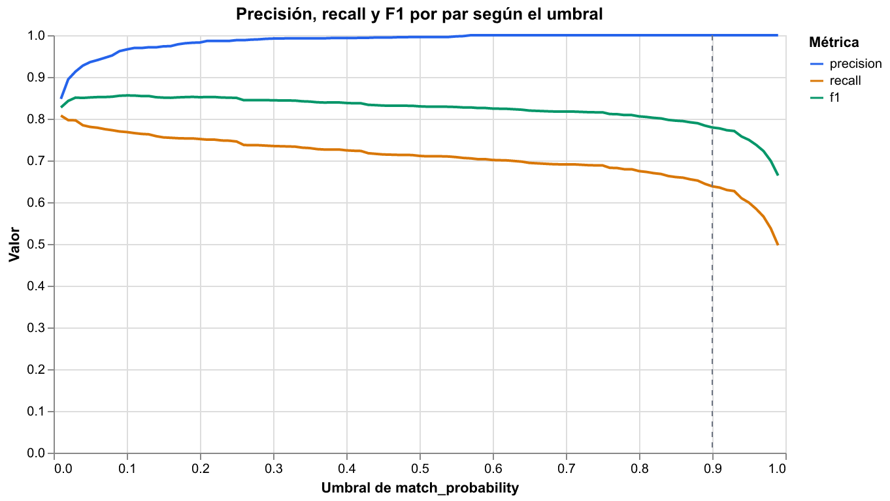
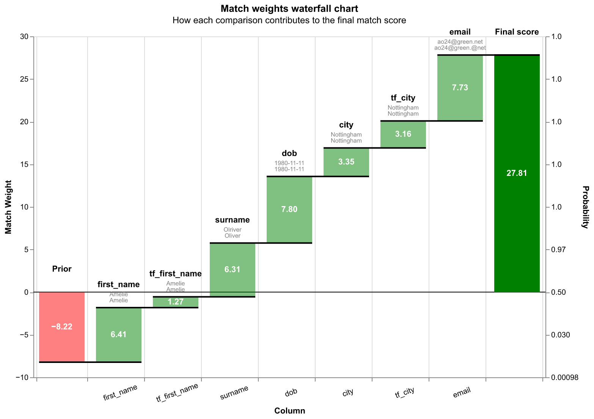

# Resolución de identidades con Splink

Caso de uso 1 de un portafolio de ciencia de datos y agentes aplicado a banca: **calidad del
dato y resolución de identidades**.

**Tableros interactivos:** [stous1.github.io/identity-resolution](https://stous1.github.io/identity-resolution/)

## Qué problema resuelve

En una base de clientes, la misma persona aparece varias veces con pequeñas diferencias: un
dígito errado en el documento, un nombre sin tilde, un teléfono viejo. Eso infla el número de
clientes, duplica comunicaciones y esconde relaciones de riesgo.

Este proyecto detecta qué registros corresponden al mismo cliente con un modelo probabilístico
Fellegi-Sunter (con [Splink](https://github.com/moj-analytical-services/splink) sobre DuckDB),
**entrenado sin etiquetas**, explica cada decisión campo por campo y mide su precisión contra
la verdad conocida.

Descripción completa del caso: [docs/caso-01-identidades.md](docs/caso-01-identidades.md).

## Hito 1: fake_1000 de punta a punta

Dataset de demostración de Splink: 1.000 registros de 251 personas, con errores de digitación,
campos vacíos y variaciones de nombres. La columna `cluster` (quién es quién) **solo se usa
para evaluar**.

**Modelo**

- Comparaciones: nombre y apellido (Jaro-Winkler con ajuste por frecuencia), fecha de
  nacimiento (niveles por distancia), ciudad (exacta con ajuste por frecuencia) y correo.
- Entrenamiento sin etiquetas: λ con reglas determinísticas, *u* por muestreo aleatorio y *m*
  con EM en dos pasadas (bloqueo por nombre+apellido y por fecha de nacimiento).
- Bloqueo de predicción: coincidencia exacta en nombre, apellido, fecha de nacimiento o
  correo. Se comparan 3.989 pares en vez de ~500.000.

**Resultados** (umbral de `match_probability` = 0,9)

| Nivel | Precisión | Recall | F1 |
|---|---|---|---|
| Por par | 1,000 | 0,638 | 0,779 |
| Por clúster (pares inducidos) | 1,000 | 0,826 | 0,905 |

- **Recall del bloqueo:** 81,2 % de los 2.031 pares verdaderos llegan a compararse; el 18,8 %
  restante no comparte ningún campo exacto y solo se recupera si la agrupación los une de
  forma transitiva.
- **Clústeres:** 345 predichos frente a 251 personas reales; 174 personas (69,3 %) quedan
  reconstruidas exactamente. No hay clústeres que mezclen personas distintas: los errores son
  personas divididas en varios clústeres.
- **Umbral:** el F1 por par es máximo con umbral 0,1 (precisión 0,966, recall 0,768, F1
  0,856). Se reporta 0,9 porque en banca unir por error a dos clientes distintos es más
  costoso que dejar un duplicado sin unir; la curva completa está abajo.

Métricas completas: [docs/resultados/metricas.json](docs/resultados/metricas.json).

### Curva por umbral



### Cascada por par

Cómo cada campo suma o resta evidencia para un par. El tablero interactivo incluye ejemplos de
acierto, falso positivo y falso negativo.



### Cluster Studio

Grafo de cada clúster predicho con sus registros y pares puntuados, priorizando los que tienen
errores.


### Tableros publicados

- [Cascada por par](https://stous1.github.io/identity-resolution/resultados/cascada.html)
- [Cluster Studio](https://stous1.github.io/identity-resolution/resultados/cluster_studio.html)
- [Comparison viewer](https://stous1.github.io/identity-resolution/resultados/comparison_viewer.html)
- [Parámetros m/u](https://stous1.github.io/identity-resolution/resultados/parametros_mu.html)
  y [pesos de coincidencia](https://stous1.github.io/identity-resolution/resultados/pesos.html)
- [Curva por umbral](https://stous1.github.io/identity-resolution/resultados/curva_umbral.html)

## Cómo correrlo

Requiere [uv](https://docs.astral.sh/uv/). uv instala Python 3.11 si hace falta.

```bash
uv sync                                       # entorno y dependencias
uv run playwright install chromium            # una sola vez, para las capturas PNG
uv run pytest                                 # pruebas (sin internet)
uv run python scripts/hito1_fake1000.py       # hito 1 completo -> reports/
uv run python scripts/publicar_resultados.py  # copia los resultados a docs/resultados/
```

La primera ejecución del hito descarga fake_1000 y lo guarda en `data/raw/`.

## Estructura

```
src/identidades/   datos, modelo, evaluación, tableros y flujo del hito
scripts/           puntos de entrada
tests/             pruebas con pytest
notebooks/         solo exploración
docs/              descripción del caso y GitHub Pages (docs/resultados/)
data/, reports/    datos y salidas de trabajo (no versionados)
```

## Regla de datos

Este repositorio **nunca usa datos reales de clientes**. Solo datasets públicos de
demostración (Splink, FEBRL) o datos sintéticos generados con Faker.
