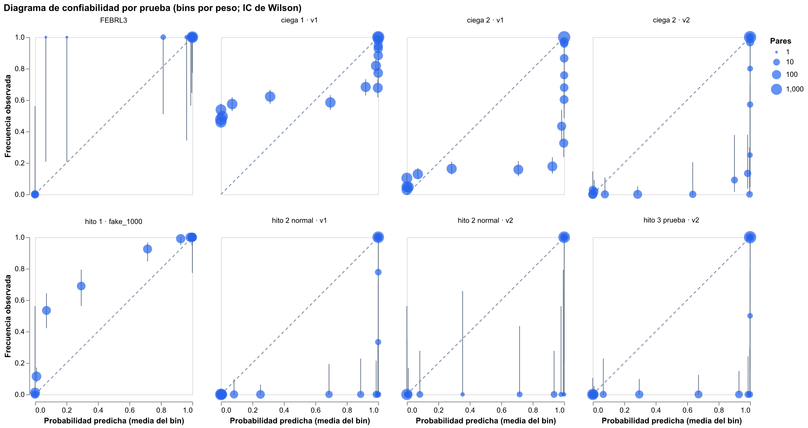
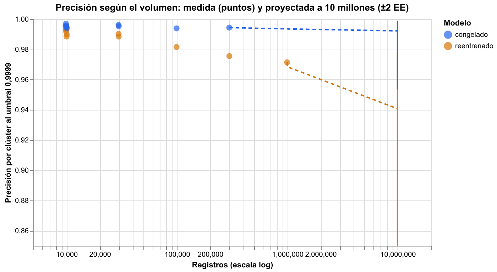

# Informe de auditoría técnica: hitos 1, 2, 2b, 3 y 5

Fecha: 18 de octubre de 2026 · Commit auditado: `afcfce1` (rama `main`, árbol limpio).

Auditoría escéptica, hecha sin haber escrito el código. No se modificó nada en `src/`,
`scripts/`, `tests/` ni `docs/`. Todo lo agregado está en `audit/`: scripts `a1` a `a8`,
pruebas en `audit/tests/`, salidas pequeñas en `audit/resultados/` e intermedias en
`audit/_cache/` (ignorada por git). Cómo reproducir todo: al final del documento.

## Resumen ejecutivo

1. **No encontré fugas de etiquetas.** Los parámetros entrenados, los pesos por par y las
   métricas son idénticos (diferencia ≤ 2·10⁻¹⁶) con la verdad barajada, sin la columna de
   verdad o con los ids renumerados. La evaluación de tiempo real tampoco filtra nada entre
   la base y las consultas.
2. **Todas las cifras publicadas se reproducen.** Una ejecución nueva de cada flujo da JSON
   idénticos a los publicados, y 114 de las 115 cifras del README y de Pages que revisé
   coinciden con esos JSON. La que no coincide es un redondeo sin importancia.
3. **El fallo del modelo v1 en la prueba ciega 1 tiene otra causa que la que dice el README.**
   El v1 aprendió dos vetos de −48 bits (municipio distinto) y −43 bits (dirección
   distinta), porque el generador del hito 2 nunca altera la ciudad ni la dirección de una
   persona. Al neutralizarlos, el recall en la ciega 1 sube de 0,636 a **0,943** con
   precisión 1,000. En esa prueba, el v1 publicado es **peor que la regla "mismo
   documento"** (F1 0,777 contra 0,931). Sin los vetos, la brecha del apellido de casada,
   que el README presenta como su hallazgo de equidad más importante, baja de −20,4 a
   −3,6 puntos y deja de ser significativa. El v2 repite la patología en `apellido_casada`
   (−72,6 bits).
4. **La caída de precisión a escala viene del reentrenamiento, no del volumen, y no se debe
   a homónimos.** Con los parámetros del v2 congelado, la precisión queda plana (0,994–0,995
   de 10 mil a 300 mil registros). El hito 5 reentrena en cada tamaño: el u de los campos
   casi únicos (teléfono, documento, correo) se divide por 10 cada vez que los datos crecen
   10 veces, y los familiares que comparten teléfono y dirección acumulan evidencia. El
   100 % de los falsos positivos son familiares. Proyección a 10 millones: **≈0,94
   [0,85–0,98] con el flujo del hito 5** y **≈0,992 [0,95–0,999] con el modelo congelado**.
   Para el flujo reentrenado, el umbral 0,9999 no sirve a gran escala: el de menor costo
   sube de 1−10⁻⁶ (10 mil registros) a más de 1−10⁻¹¹ (300 mil).
5. **Las probabilidades no están calibradas justo donde se decide.** En datos colombianos,
   los pares a los que el v2 da entre 0,9 y 0,9999 (en promedio 0,978) son verdaderos solo
   entre el 0 y el 11 % de las veces. El umbral funciona como un corte empírico de puntaje,
   no como "99,99 % de probabilidad".
6. **Lo que Splink aporta sobre reglas simples depende de la prueba.** Es grande en
   fake_1000 (+0,33 de F1) y en la prueba normal (+0,11), pero pequeño en las pruebas
   ciegas con el v2 (+0,01) y en FEBRL (+0,04). En estos datos sintéticos, el documento es
   casi una llave perfecta.
7. Las conclusiones del **hito 3** dependen de la semilla: los puentes evitan en promedio
   2 de cada 10 mezclas, no 4; al umbral congelado hay de 1 a 4 mezclas por escenario, no
   0; y la regla de supervivencia elegida cambia con la semilla.

## 1. Fugas de etiquetas (`a1_fugas.py`, `tests/test_fugas.py`)

**Revisión estática.** Ubiqué las 224 líneas de `src/identidades` que nombran la verdad
(`cluster`, `familiar_de`, `verdad`, `personas`, `existe`) y las revisé función por función
([a1_referencias_verdad.csv](resultados/a1_referencias_verdad.csv)). Todas caen en uno de
cinco grupos:

- **Generadores:** `sinteticos`, `errores_ciegos*`, `escenario_hito3`.
- **Evaluación:** `evaluacion`, `flujo.evaluar`, `registro_oro.evaluar`, `puentes.mezclados`,
  `grafo_compartido.metricas` y `tiempo_real.evaluar`.
- **Selección en desarrollo, que es legítima:** `bloqueo.seleccionar_reglas`,
  `flujo.desarrollar`, `grafo_compartido.elegir_parametros`, `registro_oro.elegir_reglas`
  y `puentes.elegir_politica`.
- **Visualización:** `tableros.seleccionar_clusters` y `escala.exportar_universo`.
- **Arrastre sin uso:** `modelo_co._finalizar` y `modelo_co_v2.preparar` copian `cluster`
  a la tabla que recibe Splink, pero ninguna comparación, regla de bloqueo ni regla
  determinística la referencia.

La estandarización, las comparaciones, el bloqueo, el clasificador de grupos (`clasificar`)
y las reglas de supervivencia (`aplicar_regla`) no tocan la verdad.

**Revisión dinámica** ([a1_fugas.json](resultados/a1_fugas.json)):

| Verificación | Resultado |
|---|---|
| Entrenar v1 y v2 (λ, u, m) con la verdad barajada | diferencia máxima 2,2·10⁻¹⁶ |
| Entrenar v1 y v2 sin la columna de verdad | diferencia máxima 1,1·10⁻¹⁶ |
| Reentrenamiento de `escala` (10 mil registros) con la verdad barajada | 1,2·10⁻¹⁶ |
| v1 congelado en la prueba normal y v2 en la ciega 2, con la verdad barajada | pesos idénticos (diferencia 0) |
| Ids renumerados al azar y filas barajadas (los generadores dan ids consecutivos por persona) | mismos pares, mismos pesos, mismas métricas |

**Tiempo real (hito 5): sin fuga.** Ningún id ni persona nueva aparece en la base. Ninguna
consulta de cliente existente es idéntica a un registro de la base (0 %), pero el 69,4 %
comparte con ella el documento estandarizado. El relleno, las tablas de frecuencia y λ se
calculan solo con la base, y el 19 % de las personas nuevas tiene un familiar en la base,
lo que da casos negativos difíciles y realistas. Lo que sí sesga la cifra no es una fuga
sino la mezcla de consultas, 50 % existentes y 50 % nuevas (ver hallazgo M5).

**No es fuga, pero es circular.** En el hito 3, el orden de canales de `registro_oro`
coincide exactamente con el orden de confiabilidad del generador, y `es_generico` marca
como relleno los 3 teléfonos, los 3 correos y las 4 direcciones de relleno que usa el
generador. El README lo reconoce para el grafo, pero no para el registro de oro.

## 2. Línea base determinística (`a2_linea_base.py`)

Las reglas usan la misma estandarización que el modelo con el que se comparan y la unión es
transitiva, igual que en la agrupación de Splink. Todas las cifras son por clúster, y las
diferencias son pareadas por persona con un IC del 95 %
([a2_linea_base.json](resultados/a2_linea_base.json)).

| Prueba | Splink P / R / F1 | Mismo documento P / R / F1 | Documento o nombre+fecha P / R / F1 | Splink − mejor regla (F1) |
|---|---|---|---|---|
| Hito 1, fake_1000 (sin documento: correo) | 0,970 / 0,851 / 0,907 | 1,000 / 0,332 / 0,498 | 1,000 / 0,401 / 0,572 | **+0,335** [+0,236, +0,428] |
| Hito 2, prueba normal, v1 | 1,000 / 0,998 / 0,999 | 1,000 / 0,611 / 0,758 | 1,000 / 0,801 / 0,889 | **+0,110** [+0,091, +0,129] |
| **Ciega 1, v1 (la cifra honesta del hito 2)** | 0,997 / 0,636 / 0,777 | 1,000 / 0,872 / 0,931 | 1,000 / 0,923 / 0,960 | **−0,183** [−0,199, −0,168] |
| Ciega 2, v1 (control) | 0,995 / 0,920 / 0,956 | 1,000 / 0,881 / 0,937 | 1,000 / 0,964 / 0,982 | −0,026 [−0,037, −0,017] |
| **Ciega 2, v2** | 0,998 / 1,000 / 0,999 | 1,000 / 0,908 / 0,952 | 1,000 / 0,979 / 0,990 | **+0,010** [+0,006, +0,013] |
| FEBRL3 | 1,000 / 0,997 / 0,998 | 1,000 / 0,833 / 0,909 | 1,000 / 0,918 / 0,957 | +0,041 [+0,030, +0,052] |
| Hito 3, escenario de prueba, v2 | 1,000 / 0,998 / 0,999 | 0,996 / 0,864 / 0,925 | 0,992 / 0,952 / 0,971 | +0,028 [+0,021, +0,036] |
| Hito 5, tiempo real | 0,999 / 0,993 | 1,000 / 0,623 | 1,000 / 0,750 | recall +0,24 |
| Escala, 1 millón | 0,971 / 0,996 / 0,984 | 0,997 / 0,623 / 0,767 | 0,997 / 0,823 / 0,901 | F1 +0,08 (sin IC) |

La regla de documento más primer apellido rinde siempre menos que la de documento solo.
Detalle en el JSON.

**¿Cuánto aporta Splink de verdad?**

- **Mucho, cuando no hay una llave fuerte o los campos varían poco.** En fake_1000, sin
  documento, aporta +0,33 de F1. En la prueba normal del hito 2 aporta +0,11, que es
  sobre todo recall.
- **Poco, en las pruebas que más se parecen a un caso nuevo.** En la ciega 2 con el v2
  aporta +0,010 de F1: 2 puntos más de recall a cambio de 0,15 puntos de precisión. En el
  hito 3 aporta +0,028 y en FEBRL +0,041. Las reglas tienen precisión 1,000 casi siempre
  porque el generador asigna documentos distintos a personas distintas; con datos reales
  (documentos reutilizados, errores sistemáticos de captura) esa ventaja de las reglas se
  reduciría.
- **El v1, en la única prueba realmente ciega que tuvo, es peor que una regla de una
  línea.** La causa está en la sección 5.
- Las reglas solo pierden precisión en el hito 3, por las suplantaciones (0,996), y a gran
  escala, donde los documentos sorteados al azar empiezan a repetirse: 0,9997 con 100 mil
  registros y 0,9973 con 1 millón. Esto último es un artefacto del generador.

## 3. Estabilidad con 5 semillas (`a3_estabilidad.py`)

Semillas 11, 22, 33, 44 y 55. Todos los conjuntos tienen menos de 10 mil registros (el más
grande es el desarrollo del v2, con unos 8.800). Cada fila repite la evaluación completa
([a3_estabilidad.json](resultados/a3_estabilidad.json)).

| Evaluación | Qué cambia | Precisión: media ± DE [mín, máx] | Recall: media ± DE [mín, máx] | Publicado (P / R) |
|---|---|---|---|---|
| Hito 1 | partición | 0,990 ± 0,015 [0,966, 1,000] | 0,869 ± 0,018 [0,855, 0,899] | 0,970 / 0,851 |
| Hito 2 (v1, desarrollo repetido) | generación y partición | 1,000 ± 0 | 0,998 ± 0,003 [0,993, 1,000] | 1,000 / 0,998 |
| Ciega 1, v1 congelado | generación | 0,995 ± 0,003 [0,991, 0,998] | 0,641 ± 0,011 [0,628, 0,654] | 0,997 / 0,636 |
| Ciega 2, v2 congelado | generación | 0,998 ± 0,002 [0,996, 1,000] | 0,9996 ± 0,0005 [0,999, 1,000] | 0,998 / 1,000 |
| Ciega 2, v1 congelado | generación | 0,996 ± 0,003 [0,991, 1,000] | 0,915 ± 0,004 [0,911, 0,921] | 0,995 / 0,920 |
| v2 con el desarrollo repetido, medido en la ciega 2 | desarrollo | 0,999 ± 0,002 [0,997, 1,000] | 0,998 ± 0,0001 | 0,998 / 1,000 |
| FEBRL3 | partición | 1,000 ± 0 | 0,998 ± 0,002 [0,996, 1,000] | 1,000 / 0,997 |
| Hito 3, unión de clientes (v2) | escenarios | 0,998 ± 0,001 [0,997, 0,999] | 0,998 ± 0,0003 | 1,000 / 0,998 |
| Hito 5, tiempo real | población | 0,999 ± 0,001 [0,997, 1,000] | 0,991 ± 0,002 [0,989, 0,994] | 0,999 / 0,993 |

**Lo que se sostiene:** las métricas principales del hito 2, de las dos ciegas, de FEBRL y
de tiempo real son estables. Las cifras publicadas caen dentro del rango de las 5 semillas
y la dispersión es menor que los intervalos bootstrap publicados.

**Lo que no es estable:**

- **El umbral.** Con 5 desarrollos repetidos del v2, el umbral de menor costo sale
  0,9999999 las 5 veces; el publicado es 0,9999, unos 10 bits de diferencia en odds. En el
  hito 2 va de 0,99999 a 0,9999999, en el hito 1 de 0,77 a 0,89 y en FEBRL de 0,78 a 0,995.
  La meseta de costo es plana: el umbral exacto casi no cambia las métricas, pero el valor
  "elegido en desarrollo" es en buena parte azar de la muestra.
- **El recall de 1,000 en la ciega 2** viene de ese umbral en particular. Con cualquiera de
  los 5 desarrollos repetidos queda en 0,998, con 0 a 20 pares mal unidos.
- **El hito 3.**
  - Al umbral congelado hay de 1 a 4 clientes mezclados por escenario (2,2 en promedio); el
    publicado tiene 0.
  - La exactitud del grafo va de 97,7 % a 99,3 %, frente al 100 % publicado.
  - Cortar puentes evita 2/18, 2/16, 2/15, 3/16 y 7/15 mezclas al umbral 0,9: **unas 2 de
    cada 10, no 4**.
  - La regla de supervivencia del documento sale "fuente más confiable" en 2 semillas y
    "validado" en 3. La de dirección sale "más frecuente" en 4 y "fuente más confiable"
    en 1. La lectura "en la identidad gana la fuente más confiable" no es robusta.
  - "A menos de 5 puntos del techo" sí se sostiene: la peor brecha va de 3,6 a 4,9 puntos.
- **El hito 1:** el recall publicado (0,851) queda en el extremo bajo y la precisión
  publicada (0,970), en la mitad baja. Es una cifra conservadora, no inflada.

## 4. Calibración (`a4_calibracion.py`)

Tomé todos los pares que pasan el bloqueo en cada prueba y los agrupé por peso de
coincidencia (bins en probabilidad esconderían casi todo, porque los valores se concentran
cerca de 0 y de 1). Intervalos de Wilson.
[Diagrama de confiabilidad](resultados/a4_confiabilidad.png) ·
[log-odds observados contra predichos](resultados/a4_logodds.png) ·
[a4_calibracion.json](resultados/a4_calibracion.json).



| Prueba | Pares | ECE | Pares con p ∈ [0,9, 0,9999): p media predicha → frecuencia observada | FP sobre el umbral: esperados → observados |
|---|---|---|---|---|
| Hito 1, fake_1000 | 1.262 | 0,082 | 0,982 → 1,000 (397 pares) | 12,3 → 1 |
| FEBRL3 | 2.636 | 0,001 | 0,995 → 1,000 (31) | 0,01 → 0 |
| Hito 2 normal, v1 | 5.120 | 0,014 | 0,984 → **0,063** (32) | 0,00 → 0 |
| Hito 2 normal, v2 | 3.390 | 0,006 | 0,962 → **0,000** (15) | 0,00 → 0 |
| Ciega 1, v1 | 12.818 | 0,241 | 0,981 → 0,746 (971) | 0,00 → **4** |
| Ciega 2, v1 | 9.655 | 0,070 | 0,975 → 0,353 (416) | 0,00 → **13** |
| Ciega 2, v2 | 6.315 | 0,012 | 0,978 → **0,108** (37) | 0,00 → **3** |
| Hito 3 prueba, v2 | 7.073 | 0,011 | 0,978 → **0,048** (42) | 0,00 → 0 |

- **Los modelos colombianos (v1 y v2) son muy sobreconfiados entre 0 y 15 bits.** Lo que
  llaman probabilidad 0,98 resulta verdadero entre el 0 y el 11 % de las veces, porque son
  casi todos familiares. Un par con p ≈ 0,9999 (12,5 a 15 bits) es verdadero solo el 57 %
  de las veces en la ciega 2 con el v2. Es la violación de independencia de
  Fellegi-Sunter dentro de un hogar, que el README menciona para un caso puntual.
- **En el punto de operación** el modelo promete ~0 falsos positivos directos y en la
  ciega 2 se observan 3 (v2) y 13 (v1).
- **El ECE engaña:** sale bajo (≤ 0,014) porque lo dominan miles de pares con más de 30
  bits que son trivialmente verdaderos.
- **fake_1000 es al revés, subconfiado:** el 53 % de los pares con p ≈ 0,07 son verdaderos.
- **Consecuencia práctica:** la "zona gris" del hito 5 ([0,9, 0,9999)) está formada en su
  mayoría por no coincidencias. No hay que leer la probabilidad como probabilidad. Si el
  agente del hito 4 la va a usar como evidencia, conviene recalibrarla (por ejemplo, con
  una regresión isotónica sobre el peso) en un desarrollo etiquetado.

## 5. Ablación (`a5_ablacion.py`)

### Pesos extremos en los modelos congelados

| Modelo | Nivel | Peso |
|---|---|---|
| v1 (`hito2-congelado-r1`) | municipio distinto | **−47,9 bits** |
| v1 | dirección con Jaro-Winkler ≥ 0,9 | **−43,1 bits** (más negativo que "distinta") |
| v2 (`hito2b-congelado`) | apellido de casada distinto | **−72,6 bits** (m = 1,3·10⁻²²) |

Un nivel con 40 a 70 bits en contra decide solo, sin importar cuántos campos coincidan.
Además, hay niveles que quedaron sin entrenar y usan los valores por defecto de Splink: en
el v1, el m de "mismo usuario de correo" y el m y el u de "misma vía, número y placa"; un
nivel del hito 1 y otro de FEBRL.

### Quitar una comparación del modelo congelado (mismo umbral y bloqueo)

| Caso | Modelo completo (P / R / F1) | Mayor cambio |
|---|---|---|
| **v1 en la ciega 1** | 0,997 / 0,636 / 0,777 | sin municipio: R **0,847**, F1 0,917. Sin dirección: R 0,721. **Sin los dos: P 1,000 / R 0,943 / F1 0,970** |
| v1 en la ciega 2 | 0,995 / 0,920 / 0,956 | sin los dos: 0,997 / 0,990 / 0,993 |
| v1 en la prueba normal | 1,000 / 0,998 / 0,999 | ninguna baja el F1 más de 0,004 |
| v2 en la ciega 2 | 0,998 / 1,000 / 0,999 | ninguna baja el F1 más de 0,0034 (fecha) |
| v2 en el hito 3 | 1,000 / 0,998 / 0,999 | sin fecha: F1 0,991 |
| Hito 1 | 0,970 / 0,851 / 0,907 | sin correo: F1 0,790; sin fecha: 0,811 |
| FEBRL3 | 1,000 / 0,997 / 0,998 | ninguna baja el F1 más de 0,003 |

### Reentrenar sin la comparación (bloqueo y umbral elegidos de nuevo en desarrollo)

- **v2** (desarrollo del hito 2b, 8.952 registros): ninguna comparación cuesta más de 0,5
  puntos de F1 en la ciega 2. Sin documento queda en 0,9947; sin fecha, 0,9961; sin
  municipio o sin dirección incluso mejora a 0,9999. En la prueba normal, la mayor pérdida
  es sin fecha (0,9918) o sin documento (0,9920).
- **Hito 1:** cada comparación aporta entre 4 y 9 puntos de F1. Es el único modelo donde
  todas pesan.

**Lectura:**

- No hay una comparación que cargue todo el resultado de forma sospechosa. Al contrario,
  el v2 es tan redundante que casi cualquier campo sobra.
- **Lo sospechoso son los vetos.** El generador del hito 2 nunca cambia la ciudad ni la
  dirección de una persona (solo mayúsculas y abreviaturas), así que EM aprendió que
  "ciudad distinta" casi nunca ocurre entre registros de la misma persona. En la ciega 1
  (ciudades abreviadas como "Bta", direcciones rurales) eso veta pares verdaderos: el
  29,2 % de los pares verdaderos de la ciega 1 recibe más de 20 bits en contra solo por el
  municipio.
- El v2 lo corrigió de rebote, porque la ciega 1 entró en su desarrollo, pero creó otro
  veto en `apellido_casada`. Hoy no se activa en ninguna prueba (quitarlo no cambia nada),
  pero dos registros de la misma mujer con apellidos de casada distintos (divorcio, nuevo
  matrimonio, error de digitación) no se unirían nunca.

### La equidad de la ciega 1, sin los vetos (diagnóstico, parte D)

| Brecha en personas exactas (ciega 1, v1) | Publicada | Sin los vetos de municipio y dirección |
|---|---|---|
| Apellido de casada | −20,4 puntos [−28,6, −11,3] | **−3,6 puntos [−9,0, +1,1], no significativa** |
| Apodo | −13,1 puntos [−18,9, −6,9] | −11,5 puntos [−15,7, −7,3], significativa |

Los intervalos de la columna "Publicada" salen de mi propia corrida del bootstrap: el
README, con su semilla, da [−29,1, −11,4] y [−19,0, −7,4].

La brecha de los apodos es real. La del apellido de casada era casi toda una interacción
con los vetos, así que la conclusión de equidad más fuerte del hito 2 está mal atribuida.

## 6. Escala y umbral según el volumen (`a6_escala.py`)

Repetí los pasos de `escala.correr` (mismo código y parámetros) con 10 mil registros (5
semillas), 30 mil (2), 100 mil y 300 mil (1 cada uno), con dos modelos en cada tamaño: el
**reentrenado** que mide el hito 5 y el **v2 congelado** con λ reestimada. El punto de 100
mil reproduce exactamente el publicado (mismos datos, comprobado byte a byte, P 0,9815 y
R 0,9967). El de 1 millón es el publicado: no lo volví a correr para no usar ~10 GB de
memoria ([a6_escala.csv](resultados/a6_escala.csv), [a6_escala.json](resultados/a6_escala.json)).

| Registros | Reentrenado P / R | Congelado P / R | FP directos entre familiares (reentrenado) | FP directos / pares de familiares (reentrenado · congelado) | Umbral de menor costo (reentrenado · congelado) |
|---|---|---|---|---|---|
| 10 mil (5 semillas) | 0,992 ± 0,002 / 0,996 | 0,995 ± 0,001 / 0,996 | 100 % | 0,015 · 0,009 | 1−10⁻⁶ a 1−10⁻⁹ · 1−10⁻⁶ a 1−10⁻⁸ |
| 30 mil (2) | 0,989 / 0,996 | 0,996 / 0,996 | 100 % | 0,019 · 0,007 | 1−10⁻⁸ · 1−10⁻⁷ a 1−10⁻⁸ |
| 100 mil | 0,982 / 0,997 | 0,994 / 0,997 | 100 % | 0,040 · 0,011 | 1−10⁻¹⁰ · 1−10⁻⁸ |
| 300 mil | 0,976 / 0,997 | 0,994 / 0,996 | 100 % | 0,055 · 0,010 | **1−10⁻¹¹ (borde de la grilla)** · 1−10⁻⁸ |
| 1 millón (publicado) | 0,971 / 0,996 | no medido | | | |



**Mecanismo.**

- Todos los clientes mezclados, en todos los tamaños, contienen solo familiares. No hay
  homónimos, documentos repetidos ni clústeres gigantes (el más grande tiene 10 registros).
- Al reentrenar con 10 veces más registros, el u de "mismo teléfono", "mismo documento" y
  "mismo correo" se divide por 10: cada uno suma unos +3,3 bits. La previa λ también se
  divide por 10 (−3,4 bits).
- Para un par cualquiera las dos cosas se compensan. Para dos familiares que comparten
  teléfono **y** dirección, que no son independientes, la evidencia sube más rápido que lo
  que baja la previa.
- Por eso los falsos positivos inducidos crecen como **N^1,29 ± 0,03**, mientras que los
  aciertos crecen como N^1,00.
- Con el modelo congelado los u quedan fijos y los falsos positivos crecen como N^1,08: la
  precisión casi no se mueve.

**Extrapolación a 10 millones, sin correrlo.**

| Ajuste | 300 mil (predicho → observado) | 1 millón (predicho → observado) | **10 millones** |
|---|---|---|---|
| Reentrenado, ajustado solo con 10 mil a 100 mil | 0,974 → 0,976 | 0,962 → 0,971 | 0,919 [0,48, 0,99] |
| Reentrenado, ajustado con todos los puntos | | | **0,941 [0,85, 0,98]** |
| Congelado, ajustado con 10 mil a 300 mil | | 0,994 [0,97, 0,999] | **0,992 [0,95, 0,999]** |

Los rangos son ±2 errores estándar de la pendiente. El ajuste hecho solo con los tamaños
chicos predijo bien 300 mil y exageró un poco la caída a 1 millón, así que la ley de
potencias es, si acaso, pesimista. El recall no cambia con el volumen (0,996 a 0,997) con
ninguno de los dos modelos.

**¿Sigue sirviendo el umbral elegido con conjuntos pequeños?**

- **Con el flujo reentrenado del hito 5, no.** El umbral de menor costo (10·FP + FN) sube
  entre 4 y 10 bits cada vez que los datos crecen 10 veces (según desde qué semilla de 10
  mil se mida) y a 300 mil ya está en el borde de la grilla. Con 1−10⁻⁷ en vez de 0,9999, la precisión con 300 mil sería 0,997 en lugar
  de 0,976, con una pérdida de recall de solo 0,0004.
- Un umbral fijo en probabilidad solo es invariante al volumen si el modelo está calibrado,
  y aquí no lo está (sección 4).
- **Con los parámetros congelados, sí.** La precisión no depende del volumen y el umbral
  óptimo queda estable en torno a 1−10⁻⁸ desde 30 mil registros. Que no sea 0,9999 se debe
  a la mezcla de datos de desarrollo del hito 2b, que incluía la ciega 1, más difícil, y no
  al volumen.
- **Recomendación:** a escala, entrenar m y u una vez con una muestra y congelarlos, en
  lugar de reentrenar en cada lote. Si se reentrena, el umbral debe recalibrarse con una
  muestra etiquetada (revisión manual) en cada orden de magnitud.

**Advertencias.**

- Los datos de escala salen solo del generador del hito 2. Su único mecanismo de error caro
  son los hogares (el 25 % de las personas tiene un familiar), así que la proyección dice
  poco sobre datos reales, donde aparecen homónimos de verdad, documentos reutilizados y
  datos de relleno más variados.
- A partir de 1 millón el generador produce documentos repetidos al azar entre personas
  distintas (la regla de documento pierde precisión), algo que no pasa con cédulas reales.
- **Tiempo real a escala** (`a8_tiempo_real.py`): con bases de 1.351, 4.588 y 13.649
  clientes, la precisión es 0,999, 0,999 y 0,998, y el recall 0,993, 0,994 y 0,991. La tasa
  de personas nuevas confundidas con un cliente se mantiene en 0,1 %, y en la base más
  grande aparece el primer "cliente equivocado". La previa 1/N no influye: con π/N, para
  π = 0,5 y 0,1, ninguna decisión cambia, porque los pesos quedan lejos del umbral. La
  latencia mediana sube con el tamaño de la base (74, 107 y 167 ms, medidas con la máquina
  ocupada por otras corridas de esta auditoría).

## 7. Contraste de afirmaciones (`a7_afirmaciones.py`, `tests/test_afirmaciones.py`)

- **Ejecución nueva de cada flujo, comparada con lo publicado** (todo número, salvo
  tiempos): hito 1, hito 2 (métricas y modelo), validación, desarrollo y evaluación del
  hito 2b, hito 3 y tiempo real del hito 5 dan **0 diferencias**. La única diferencia en
  los `modelo.json` es el `linker_uid` aleatorio de Splink. La escala con 100 mil se
  reproduce exactamente. La de 1 millón no se volvió a correr.
- **Cifras del README y de Pages contra los JSON:** 115 cifras, cada una reconstruida desde
  el JSON con el mismo redondeo y buscada literalmente en el texto
  ([a7_afirmaciones.json](resultados/a7_afirmaciones.json)). **114 coinciden.**
- **Discrepancias menores:**
  - `docs/hito5.md` dice "240 mil enlaces"; son 240.855, que redondea a 241 mil.
  - `docs/hito5.md` y el README dicen que la memoria pico "es acumulada: lo de una etapa
    sigue en memoria en la siguiente". Con 100 mil, el pico de la predicción (1,03 GB) es
    menor que el del entrenamiento (1,54 GB), así que el pico no se acumula entre etapas.
- **No verificables desde las salidas:** "sin el SQL compilado, ~280 ms"; "17 tipos de
  error nuevos"; el caso de las hermanas ZAPATA ROMERO con peso 18,0; "6 clientes
  marcados en la ciega 2 con puentes de peso < 25"; el historial "81,7 %" del hito 1.
- **Afirmaciones cualitativas que los datos contradicen:**
  - "La precisión baja un punto con 10 veces más registros: hay más homónimos con datos
    parecidos" (`docs/hito5.md`): son familiares, no homónimos, y la caída se debe al
    reentrenamiento (sección 6).
  - La explicación de "Dónde falla" en la ciega 1 y el "hallazgo de equidad más
    importante": ver la sección 5.

## 8. Hallazgos por gravedad

### Alta

| # | Hallazgo | Evidencia |
|---|---|---|
| A1 | **El v1 aprende vetos de 43 a 48 bits** (municipio, dirección) porque el generador del hito 2 nunca altera esos campos. Explican la mayor parte del recall perdido en la ciega 1 (0,636 → 0,943 al neutralizarlos), hacen que el v1 sea peor que la regla "mismo documento" en su prueba ciega y convierten la brecha del apellido de casada en un artefacto en buena parte. El README atribuye el fallo a nombres cruzados, documentos y fijos, que son causas secundarias. El v2 trae un veto nuevo de −72,6 bits en `apellido_casada`. | §2, §5; `a5_ablacion.json` (A, B, D) |
| A2 | **La caída de precisión a escala del hito 5 se debe al reentrenamiento por tamaño, y el umbral fijo no escala con ese flujo.** El 100 % de los falsos positivos son familiares, no homónimos. Con los parámetros congelados la precisión queda plana. Proyección a 10 millones: 0,94 [0,85–0,98] reentrenado y 0,992 congelado. | §6; `a6_escala.json` |
| A3 | **Probabilidades sobreconfiadas en la zona de decisión:** p ≈ 0,98 → 0–11 % de verdaderos en datos colombianos, y falsos positivos sobre el umbral que el modelo no espera. Afecta cualquier uso de la probabilidad como probabilidad (zona gris, agente del hito 4). | §4; `a4_calibracion.json` |

### Media

| # | Hallazgo | Evidencia |
|---|---|---|
| M1 | El README no compara contra reglas simples. En las pruebas ciegas con el v2 y en el hito 3, Splink aporta +0,01 a +0,03 de F1 sobre "documento o nombre+fecha", en datos donde el documento es una llave casi perfecta por construcción. | §2 |
| M2 | El umbral "elegido en desarrollo" no es estable: el v2 redesarrollado da 0,9999999 en 5/5 semillas (publicado 0,9999), y el recall de 1,000 en la ciega 2 depende de esa elección (0,998 con los otros desarrollos). | §3 |
| M3 | Las cifras del hito 3 son un sorteo favorable: puentes ~2 de cada 10 (publicado 4), de 1 a 4 mezclas al umbral congelado (publicado 0), exactitud del grafo de 97,7 a 99,3 % (publicado 100 %) y reglas de supervivencia que cambian con la semilla. | §3 |
| M4 | El hito 3 está diseñado con conocimiento del generador: el orden de canales es idéntico a la confiabilidad del generador y la regla de relleno marca exactamente los valores de relleno del generador. El registro de oro y el grafo quedan optimistas por construcción. | §1 |
| M5 | La precisión de tiempo real (0,999) supone 50 % de consultas de clientes existentes. Con las tasas observadas, una prevalencia del 10 % daría 0,991 y una del 1 %, 0,909. Además, la evaluación usa el mismo generador del desarrollo: equivale a la prueba normal, no a una ciega. | §1, §6; `a8_tiempo_real.json` |

### Baja

| # | Hallazgo |
|---|---|
| B1 | Niveles sin entrenar que usan los valores por defecto de Splink en los modelos congelados (v1: dos niveles; hito 1 y FEBRL: uno cada uno). |
| B2 | Artefactos del generador: la ciudad, la dirección (en el hito 2) y la fecha (en el escenario del hito 3, techo trivial de 100 %) nunca se alteran, y los documentos sorteados al azar colisionan a escala. |
| B3 | Pages: "240 mil enlaces" (son 241 mil) y "memoria acumulada" (los picos no se acumulan). |
| B4 | La prueba normal del hito 2 se inspeccionó (casos difíciles de prueba en el README) antes de desarrollar el v2, así que la fila "prueba normal · v2" no es una medición virgen. Impacto pequeño: el v2 no ataca esos casos. |
| B5 | La latencia de tiempo real crece con el tamaño de la base (74 → 167 ms de mediana con la máquina cargada) y se publicó solo con 1.351 clientes. |

## 9. Opinión: ¿qué conclusiones del README se sostienen?

**Se sostienen:**

- La metodología de partición por persona, la medición única en prueba y el bootstrap
  están bien hechos y son reproducibles al dígito. No hay fugas de etiquetas.
- Hito 1: las cifras de prueba son honestas e incluso algo conservadoras. Splink sí aporta
  mucho sobre reglas simples en fake_1000.
- Hito 2: la estandarización aporta (diferencia pareada significativa) y las métricas de la
  prueba normal son estables entre semillas. El propio README ya advierte que esa prueba
  es optimista.
- Prueba ciega 1: la cifra (recall 0,636) es correcta y representativa (0,641 ± 0,011), y
  presentarla como "la cifra honesta" es una práctica valiosa.
- Hito 2b: el v2 mejora al v1 sobre las mismas personas de la ciega 2 (+8 puntos de
  recall) y es estable entre muestras de la ciega 2 (P 0,998, R 0,9996).
- Hito 3: el registro de oro queda a menos de 5 puntos del techo, y "usar siempre el más
  reciente sería igual o peor" se cumple en los 7 campos.
- Hito 5: la evaluación de tiempo real no tiene fugas, se reproduce y aguanta bases 10
  veces más grandes. Las cifras de tiempo y memoria de escala coinciden con las salidas.

**No se sostienen o hay que matizarlas:**

- **"Dónde falla" en la ciega 1 y "el modelo falla más con mujeres que usan apellido de
  casada"** como hallazgo principal. La causa dominante son dos vetos aprendidos de un
  generador que nunca cambia la ciudad ni la dirección; sin ellos, la brecha del apellido
  de casada no es significativa. La de apodos sí es real.
- **"La precisión aguanta"** en la ciega 1 es cierto, pero oculta que una regla de una
  línea es mejor en todo lo demás.
- **La caída de precisión a escala "por homónimos"** es falsa: son familiares y se debe al
  reentrenamiento. Con ese flujo, a 10 millones cabe esperar una precisión de ~0,94 y no
  algo cercano a 0,97. Con parámetros congelados, ~0,99.
- **Los umbrales "elegidos en desarrollo"** son en buena parte azar de la muestra, y la
  probabilidad que se compara con ellos no está calibrada. El 1,000 de recall en la ciega
  2 es el extremo favorable.
- **Hito 3:** "4 de cada 10 mezclas evitadas", "0 uniones erróneas al umbral congelado",
  "432 grupos bien clasificados" y "en la identidad gana la fuente más confiable" son
  resultados de una semilla favorable. El promedio es más modesto.
- **"Precisión 0,999" en tiempo real** vale para una mezcla 50/50 de consultas. Con una
  prevalencia realista de clientes existentes en el flujo de consultas, la precisión baja.

**En una frase:** la ingeniería y la disciplina de evaluación son sólidas y honestas en los
números, pero varias interpretaciones del README atribuyen los resultados al modelo cuando
los explican las propiedades del generador sintético: campos que nunca cambian, documentos
únicos por construcción y hogares como única fuente de confusión. Lo que más falta es una
línea base, una prueba de calibración y repetir con varias semillas antes de afirmar.

## Cómo reproducir

Desde la raíz del repositorio, con el entorno del proyecto (`uv run` o
`.venv/Scripts/python.exe`). En Windows conviene `PYTHONIOENCODING=utf-8`.

```bash
uv run python audit/a1_fugas.py              # ~1 min
uv run python audit/a2_linea_base.py         # ~6 min (lee data/escala si existe; no escribe ahí)
uv run python audit/a3_estabilidad.py        # ~40 min; acepta nombres de evaluación
uv run python audit/a4_calibracion.py        # ~2 min
uv run python audit/a5_ablacion.py           # A y B ~3 min; C ~25 min; D ~1 min
uv run python audit/a6_escala.py             # ~15 min, pico ~4 GB con 300 mil
uv run python audit/a7_afirmaciones.py cifras rerun   # cifras: segundos; rerun ~25 min
uv run python audit/a8_tiempo_real.py        # ~15 min
uv run pytest audit/tests                    # 9 pruebas, ~15 s
```

Ningún script de auditoría termina procesos ajenos ni escribe fuera de `audit/`.
