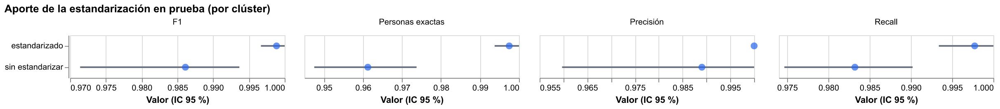
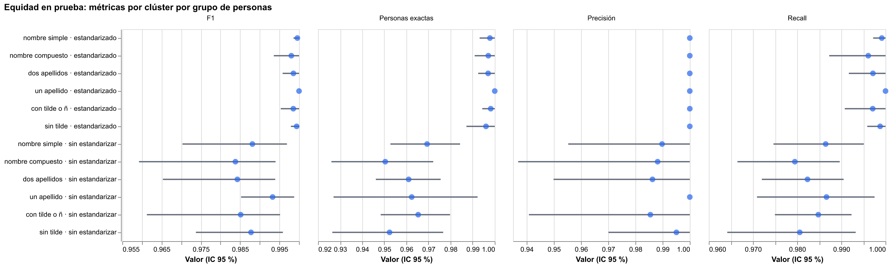
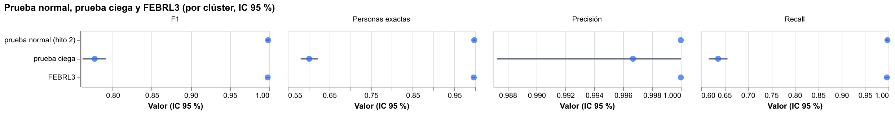
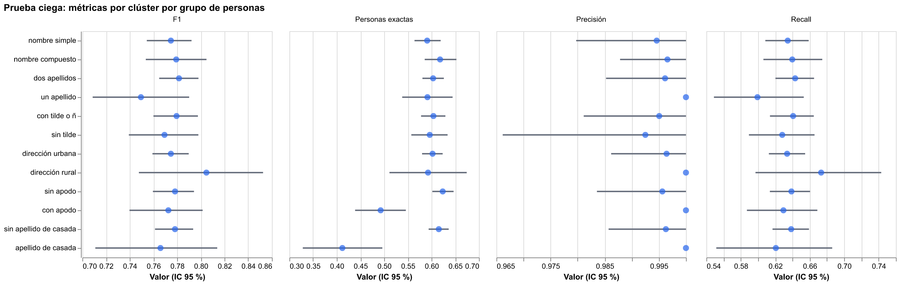

# Hito 2: clientes sintéticos colombianos y estandarización

[← Volver a la portada](index.md) ·
[Descripción completa en el README](https://github.com/stous1/identity-resolution#hito-2-clientes-sintéticos-colombianos-y-estandarización)

2.000 personas sintéticas generadas con Faker `es_CO` (4.851 registros con errores de
captura, familiares que comparten apellidos y dirección, y datos de relleno compartidos).
Bloqueo y umbral se eligen en desarrollo (1.200 personas) y las métricas se miden en prueba
(800 personas), con intervalos de confianza del 95 % por bootstrap de personas.

## Resultados en prueba

| Variante | Precisión por clúster | Recall por clúster | Personas exactas |
|---|---|---|---|
| **Estandarizado** | **1,000** [1,000 – 1,000] | **0,998** [0,993 – 1,000] | **99,8 %** [99,4 – 100] |
| Sin estandarizar (mismo modelo) | 0,989 [0,960 – 1,000] | 0,983 [0,975 – 0,990] | 96,1 % [94,8 – 97,4] |

La estandarización suma +1,5 puntos de recall por clúster y +3,6 puntos de personas
reconstruidas exactamente (ambas diferencias significativas). Con ella, el modelo no falla
más con ningún grupo: nombre simple o compuesto, uno o dos apellidos, con o sin tilde.

Detalle en [metricas.json](resultados/hito2/metricas.json) y una
[muestra de registros](resultados/hito2/muestra_registros.csv).

## Prueba ciega y FEBRL3

El modelo se congeló y se aplicó sin ajustes a datos con errores de un generador escrito
por un subagente que no conocía la estandarización. Esa es la cifra honesta:

| Evaluación | Precisión por clúster | Recall por clúster | Personas exactas |
|---|---|---|---|
| Prueba normal | 1,000 [1,000 – 1,000] | 0,998 [0,993 – 1,000] | 99,8 % |
| **Prueba ciega** | **0,997** [0,987 – 1,000] | **0,636** [0,616 – 0,657] | **60,2 %** |
| FEBRL3 | 1,000 [1,000 – 1,000] | 0,997 [0,992 – 1,000] | 99,6 % |

La precisión aguanta y el recall se cae. En la prueba ciega, el modelo falla más con
mujeres con apellido de casada (41 % de personas exactas frente a 62 %) y con personas que
usan apodo (49 % frente a 62 %).

Detalle en [metricas.json](resultados/validacion/metricas.json) y
[Cluster Studio de la prueba ciega](resultados/validacion/ciega_cluster_studio.html).

## Tableros

De prueba (modelo estandarizado):

- [Cascada por par](resultados/hito2/cascada.html)
- [Cluster Studio](resultados/hito2/cluster_studio.html)
- [Comparison viewer](resultados/hito2/comparison_viewer.html)

De desarrollo:

- [Parámetros m/u](resultados/hito2/parametros_mu.html) y
  [pesos de coincidencia](resultados/hito2/pesos.html)
- Curvas por umbral: [por par](resultados/hito2/curva_umbral.html),
  [por clúster](resultados/hito2/curva_umbral_clusters.html) y
  [costo](resultados/hito2/costo_umbral.html)
- [Equidad](resultados/hito2/equidad.html) y
  [aporte de la estandarización](resultados/hito2/estandarizacion.html)

Todos los datos son sintéticos: ninguno corresponde a una persona real.
