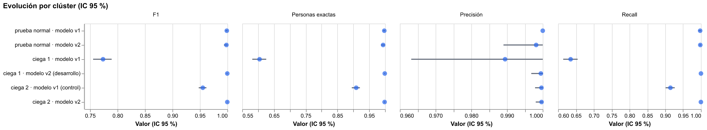
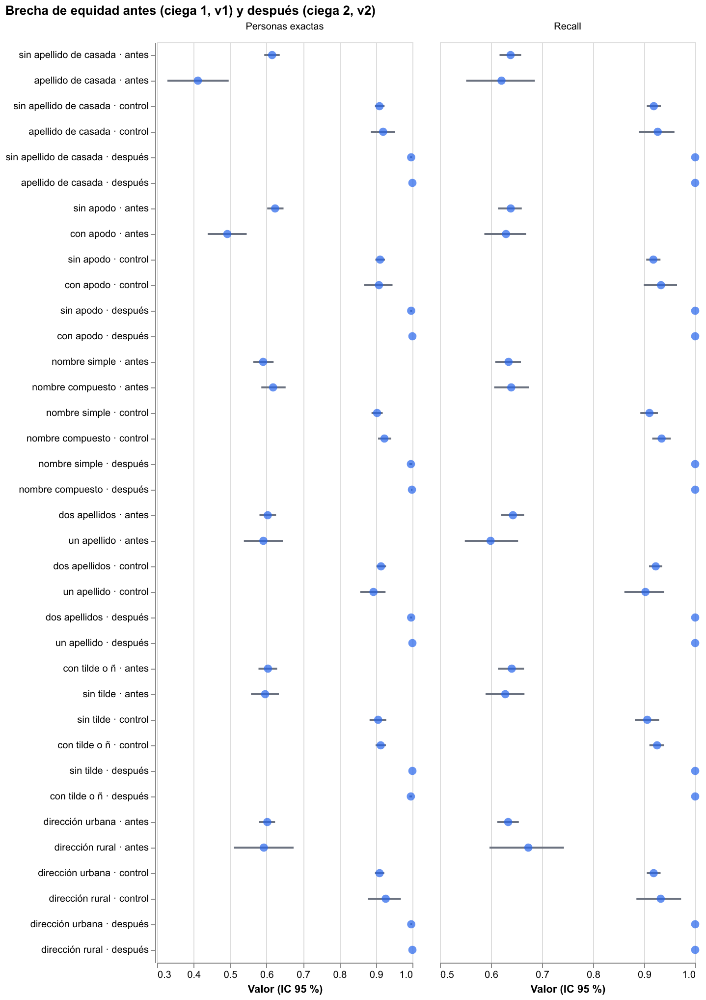

# Hito 2b: corregir y volver a medir a ciegas

[← Volver a la portada](index.md) · [Hito 2](hito2.md) · [Hito 3](hito3.md) ·
[Detalle en el README](https://github.com/stous1/identity-resolution#hito-2b-corregir-y-volver-a-medir-a-ciegas)

La prueba ciega 1 pasó a ser desarrollo. Con ella se corrigieron el apellido de casada, los
apodos, los nombres en otro campo, el documento alterado, los teléfonos y, como extra, las
fechas en otros formatos. El modelo se congeló (tag `hito2b-congelado`) y se midió con una
prueba ciega 2, escrita por un subagente que no conocía nada de lo anterior.

## Evolución (por clúster, IC 95 %)

| Evaluación | Precisión | Recall | Personas exactas |
|---|---|---|---|
| Ciega 1 · modelo v1 | 0,997 | 0,636 | 60,2 % |
| Ciega 2 · modelo v1 (control) | 0,995 [0,977 – 1,000] | 0,920 [0,907 – 0,932] | 91,1 % |
| **Ciega 2 · modelo v2** | **0,998** [0,994 – 1,000] | **1,000** [1,000 – 1,000] | **99,7 %** |
| Prueba normal · modelo v2 | 1,000 | 0,993 [0,986 – 0,999] | 99,5 % |

La ciega 2 es más fácil que la ciega 1 (el control lo muestra), así que la mejora atribuible
al modelo es la diferencia pareada sobre las mismas personas: **+8,0 puntos de recall y
+8,6 de personas exactas**, sin perder precisión.

## Brecha de equidad

| Grupo | Antes (ciega 1, v1) | Control (ciega 2, v1) | Después (ciega 2, v2) |
|---|---|---|---|
| Con apellido de casada | 41,2 % | 92,0 % | 100 % |
| Sin apellido de casada | 61,5 % | 91,0 % | 99,7 % |
| Con apodo | 49,3 % | 90,8 % | 100 % |
| Sin apodo | 62,4 % | 91,1 % | 99,7 % |

En la ciega 2 no hay brecha. Pero tampoco la hay con el modelo v1 en esos datos, así que la
ciega 2 no confirma por sí sola la corrección del caso de la ciega 1. Lo que sí muestra es
que en datos nunca vistos no aparece una brecha nueva.

## Tableros

- [Equidad en la ciega 2](resultados/hito2b/ciega2_equidad.html)
- [Cluster Studio de la ciega 2](resultados/hito2b/ciega2_cluster_studio.html)
- [Métricas](resultados/hito2b/metricas.json) y
  [muestra de registros de la ciega 2](resultados/hito2b/ciega2_muestra_registros.csv)
