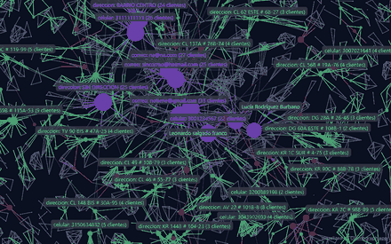
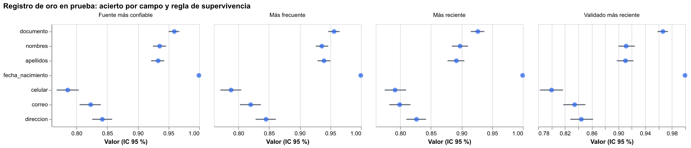

# Hito 3: registro de oro, grafo de identidad compartida y puentes

[← Volver a la portada](index.md) ·
[Detalle en el informe técnico](https://github.com/stous1/identity-resolution/blob/main/INFORME_TECNICO.md#hito-3-registro-de-oro-grafo-de-identidad-compartida-y-puentes)

**[Abrir el universo de registros en Cosmograph →](hito3_universo.html)**

Escenario con historia en el tiempo (cambios de celular, correo y domicilio), metadatos por
registro (fecha, canal y validación) y datos compartidos con verdad conocida: relleno,
hogares y patrones sospechosos (anillos y suplantaciones). Reglas y umbrales elegidos en un
escenario de desarrollo y medidos en otro de prueba (2.000 personas, 4.839 registros), con
los clientes del modelo v2 congelado.

**Las cifras de esta página son de un par de semillas (3030/3131), que resultó favorable.**
Repetido con 8 pares (hito 6, media ± DE):

| Cifra | Semilla publicada | 8 semillas |
|---|---|---|
| Peor brecha del registro de oro al techo | 4,7 puntos | 4,1 ± 0,5 (3,6 – 4,9) |
| Exactitud del grafo compartido | 100 % | 98,6 % ± 0,8 (97,7 – 100) |
| Clientes mezclados al umbral congelado | 0 | 1,5 ± 1,3 (0 – 4) |
| Mezclas evitadas cortando puentes (umbral 0,9) | 39 % | 31 % ± 18 % (13 – 56) |

La regla de supervivencia elegida para documento, nombres, apellidos y dirección cambia con
la semilla; la de celular y correo ("validado") es estable. El recall perdido al cortar
puentes solo se midió con la semilla publicada (tabla de abajo). Detalle en
[hito3_semillas.json](resultados/hito6/hito3_semillas.json).

## Registro de oro (prueba, semilla publicada)

| Campo | Regla elegida | Acierto | Techo alcanzable |
|---|---|---|---|
| Documento | Fuente más confiable | 95,6 % | 97,2 % |
| Nombres | Fuente más confiable | 92,8 % | 96,1 % |
| Apellidos | Fuente más confiable | 93,6 % | 96,6 % |
| Fecha de nacimiento | Más reciente | 100 % | 100 % |
| Celular | Validado más reciente | 80,4 % | 83,7 % |
| Correo | Validado más reciente | 82,9 % | 86,1 % |
| Dirección | Más frecuente | 83,9 % | 88,6 % |

## Grafo de identidad compartida

Los 432 grupos de datos compartidos de prueba (386 de hogar, 36 sospechosos y 10 de
relleno) quedan bien clasificados con reglas explicables. Es una cota optimista: el
escenario y el clasificador los escribió la misma persona.

## Puentes

| Umbral | Política | Clientes mezclados | Recall perdido |
|---|---|---|---|
| 0,9999 (congelado) | No cortar | 0 → 0 | 0 |
| 0,99 | Cortar puentes con peso < 15 | 8 → 5 | 0 |
| 0,9 | Cortar puentes con peso < 15 | 18 → 11 | 0 |

El caso 109-844 del hito 1 y las 3 uniones erróneas del modelo v2 en la prueba ciega 2
cuelgan de un puente débil. La [cola de revisión](resultados/hito3/cola_revision.csv)
(7 puentes débiles y 36 grupos sospechosos) es la entrada del agente del hito 4.

Detalle en [metricas.json](resultados/hito3/metricas.json).
