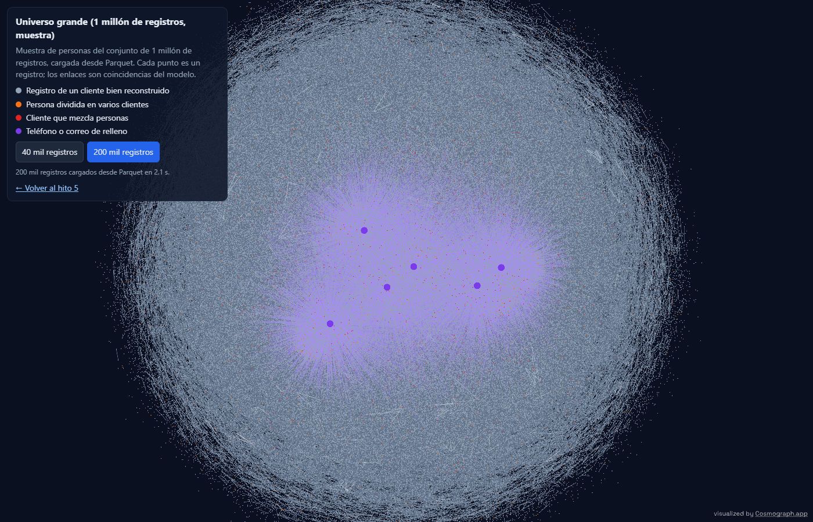
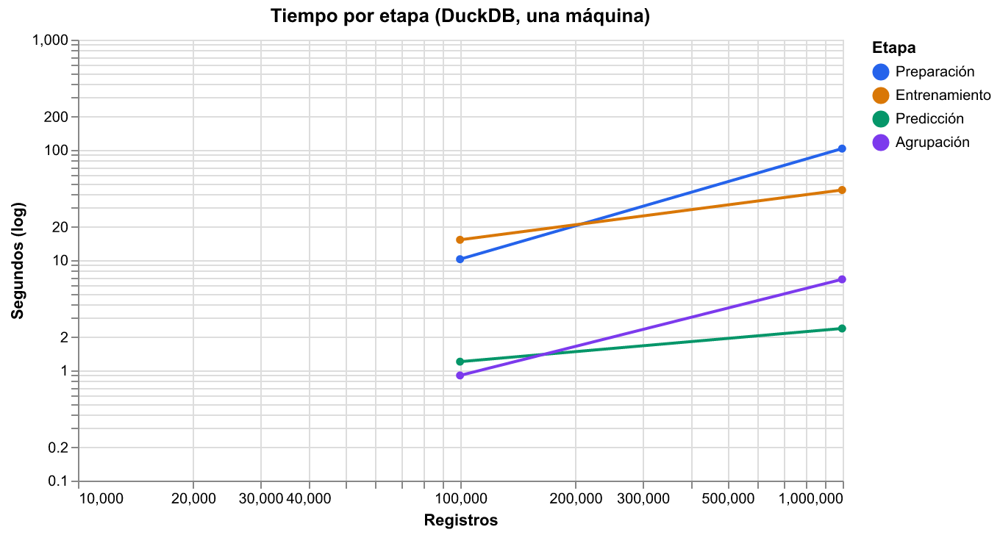
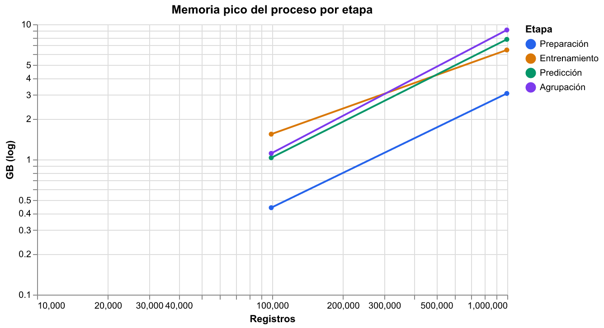

# Hito 5: vinculación en tiempo real y escala

[← Volver a la portada](index.md) ·
[Detalle en el informe técnico](https://github.com/stous1/identity-resolution/blob/main/INFORME_TECNICO.md#hito-5-vinculación-en-tiempo-real-y-escala)

**[Abrir el universo grande en Cosmograph →](hito5_universo.html)**

## ¿Ya es cliente? (tiempo real)

Llega un registro nuevo por un canal y hay que responder en el momento si la persona ya es
cliente. La base son los **registros de oro** de los clientes que arma el modelo v2
congelado (tag `hito2b-congelado`) con las reglas de supervivencia del hito 3. Cada
consulta se compara con esa base usando el mismo modelo, sin reentrenar ni ajustar nada:

- **cliente** si la probabilidad supera el umbral congelado (0,9999);
- **revisar** si queda entre 0,9 y ese umbral (zona gris);
- **nuevo** en otro caso.

La probabilidad previa se fija de antemano en 1 / número de clientes (la consulta es, como
mucho, uno de ellos). Umbral y zona gris también son fijos: ninguna decisión mira las
consultas de evaluación, así que las cifras son de prueba, medidas una sola vez.

**Evaluación:** 3.000 personas sintéticas. De las personas con dos o más registros, el 70 %
está en la base (1.351 clientes, a partir de 2.916 registros) y de cada una se aparta un
registro como consulta; el resto son personas nuevas. 2.000 consultas: 1.000 de clientes
existentes y 1.000 de personas nuevas. Un acierto exige además encontrar **el cliente
correcto**.

| Métrica | Valor | IC 95 % |
|---|---|---|
| Precisión (decisión "cliente") | 0,999 | 0,997 – 1,000 |
| Recall (clientes existentes reconocidos) | 0,993 | 0,987 – 0,998 |
| Cliente equivocado | 0 de 994 | |
| Latencia mediana | 60 ms | |
| Latencia p95 | 74 ms | |
| Latencia máxima | 162 ms | |

*Corrección de la auditoría:* esa precisión supone 50 % de consultas de clientes
existentes. Con las tasas de esta misma evaluación (993 aciertos entre 1.000 existentes y
1 falsa alarma entre 1.000 nuevas), con 10 % de clientes la precisión sería **0,991** y con
1 %, **0,909**: una falsa alarma cada 1.000 personas nuevas pesa mucho más cuando casi
todas las consultas son nuevas. Las cifras de 0,994 y 0,94 del [hito 6](hito6.md) son del
modelo v3, con otra base y otro umbral.

| Decisión | Existentes | Nuevas |
|---|---|---|
| cliente | 993 | 1 |
| revisar | 0 | 6 |
| nuevo | 7 | 993 |

Intervalos por bootstrap de consultas (1.000 réplicas). La latencia es por consulta e
incluye bloqueo, comparación y explicación; Splink genera el SQL una vez y después solo se
vuelve a ejecutar en DuckDB (sin esto, unos 280 ms por consulta).

**Servicio local:** `uv run python scripts/servicio_local.py` levanta una API con FastAPI
en `http://127.0.0.1:8000/docs`. `POST /consultar` recibe un registro crudo y devuelve la
decisión, la probabilidad, el cliente encontrado y la explicación por campo (peso de cada
comparación). Es solo para uso local: no se publica ningún servicio. *Desde el hito 6, el
servicio usa por defecto el modelo v3 con la zona gris por bandas de peso;
`--modelo v2` reproduce el de esta página (zona gris p ≥ 0,9).*

## Escala con DuckDB

Mismo esquema v2 sobre 100 mil y 1 millón de registros sintéticos, en una sola máquina (24
núcleos, 63 GB de RAM) y sin Spark. Cada tamaño corre en un proceso propio. La memoria es el
pico del proceso (incluye DuckDB) medido durante cada etapa. *Corrección de la auditoría:*
los picos no se acumulan entre etapas (con 100 mil, la predicción usa 1,03 GB y el
entrenamiento 1,54 GB).

| Registros | Etapa | Segundos | Memoria pico (GB) |
|---|---|---|---|
| 99.088 | Preparación | 8,3 | 0,44 |
| 99.088 | Entrenamiento | 13,1 | 1,54 |
| 99.088 | Predicción | 1,1 | 1,03 |
| 99.088 | Agrupación | 0,8 | 1,11 |
| 995.688 | Preparación | 90,6 | 3,08 |
| 995.688 | Entrenamiento | 35,6 | 6,46 |
| 995.688 | Predicción | 1,9 | 7,74 |
| 995.688 | Agrupación | 5,8 | **9,08** |

| Registros | Precisión | Recall | Clientes exactos |
|---|---|---|---|
| 99.088 | 0,982 | 0,997 | 97,8 % |
| 995.688 | 0,971 | 0,996 | 96,6 % |

- **El cuello de botella es la preparación** (estandarización en Python, fila por fila):
  91 s de 134 s con 1 millón. Entrenar, predecir y agrupar en DuckDB toma 43 s.
- **5 millones no cabe en esta máquina.** Con 1 millón el proceso llega a **9,1 GB** en la
  agrupación; la corrida de 5 millones se detuvo por falta de memoria del sistema y no se
  reporta. Escalar más pide liberar artefactos entre etapas, DuckDB sobre disco o un motor
  distribuido.
- A escala, el modelo se reentrena sin etiquetas con dos ajustes respecto al hito 2b: los
  correos de relleno se anulan antes de bloquear (como ya se hacía con los teléfonos) y los
  bloques de EM no usan la fecha de nacimiento sola. Si no, el bloqueo crece con el cuadrado.
- ~~La precisión baja un punto con 10 veces más registros: hay más homónimos.~~
  **Corrección de la auditoría:** el 100 % de los falsos positivos son **familiares**
  (hogares que comparten teléfono y dirección), no homónimos, y la caída se debe a
  **reentrenar en cada tamaño**: el u de los campos casi únicos se divide por 10 cada vez
  que los datos crecen 10 veces y la evidencia de los familiares crece más rápido que lo
  que baja la previa. Con los parámetros congelados la precisión queda plana (ver el
  [hito 6](hito6.md#escala-con-el-modelo-congelado)). Precisión y recall son por clúster.

Tabla completa: [escala.csv](resultados/hito5/escala.csv). Resultados de tiempo real:
[tiempo_real.json](resultados/hito5/tiempo_real.json).

## Universo grande

La [página de Cosmograph](hito5_universo.html) carga desde Parquet una muestra de personas
del conjunto de 1 millón: **200 mil registros** (241 mil enlaces, 1,8 MB) o una versión
liviana de **40 mil** (0,4 MB), que es la que abre por defecto en el celular. En gris los
registros de clientes bien reconstruidos, en naranja las personas divididas en varios
clientes, en rojo los clientes que mezclan personas y en morado los teléfonos y correos de
relleno. Los datos completos de escala no se versionan; solo estas muestras.
