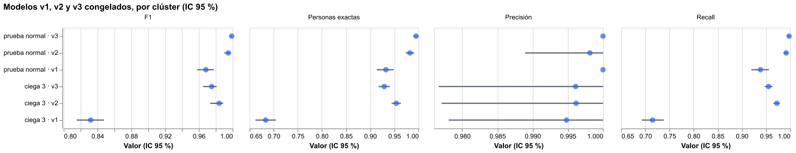
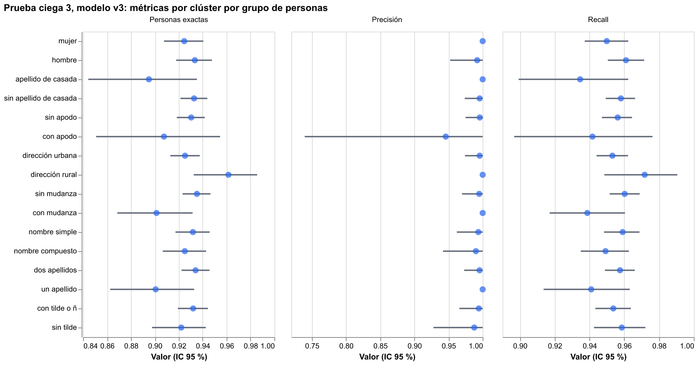
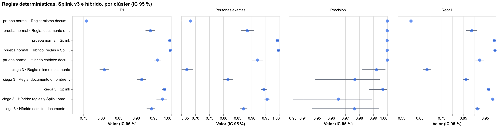
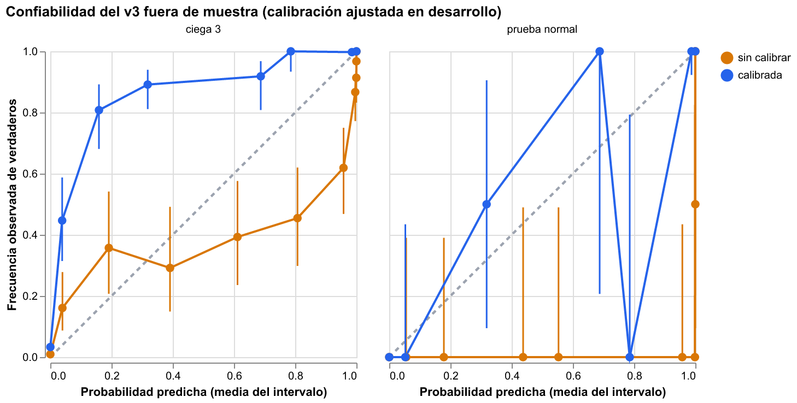

# Hito 6: correcciones post-auditoría

[← Volver a la portada](index.md) ·
[Detalle en el informe técnico](https://github.com/stous1/identity-resolution/blob/main/INFORME_TECNICO.md#hito-6-correcciones-post-auditoría) ·
[Informe de auditoría](https://github.com/stous1/identity-resolution/blob/main/audit/INFORME.md)

Una sesión de auditoría independiente revisó los hitos 1 a 5 sin haber escrito el código.
No encontró fugas de etiquetas y reprodujo todas las cifras. Pero mostró que varias
interpretaciones atribuían al modelo lo que explicaban las propiedades del generador
sintético. Este hito corrige eso con las mismas reglas de siempre: todo se decide en
desarrollo, el modelo se congela y se mide una sola vez en una prueba ciega nueva.

## Qué cambió

1. **Generador con historia:** mudanzas (dirección nueva y, en la mitad de los casos, otra
   ciudad) y apellidos de casada, con divorcio o nuevo matrimonio
   (`sinteticos.agregar_historia`). Sin esto, el modelo aprendía que "municipio distinto"
   no ocurre nunca en la misma persona y lo convertía en un veto.
2. **Modelo v3 sin vetos extremos:** un piso a las probabilidades m hace que ningún campo reste más
   de B bits. B se eligió en desarrollo entre 5 y 20: **10 bits** (los valores de 10 a 20
   empatan en costo y se toma el más estricto). El peor peso negativo pasa de −47,9 bits
   (v1, municipio) y −72,6 (v2, apellido de casada) a **−10,0** (v3, fecha a más de un año).
   Con mudanzas en los datos, EM ya no aprende vetos extremos; el piso es la red de
   seguridad. Eso no impide que un campo decida solo: en la ciega 3, el v3 a su umbral
   rechaza **257** pares verdaderos por un solo campo (fecha 103, documento 53), frente a
   197 del v2; con el umbral del v2, el v3 rechaza 145.
3. **Prueba ciega 3:** generador escrito por un subagente nuevo, sin acceso a la
   estandarización, los modelos, los generadores anteriores, la documentación ni la
   auditoría. Que sea posterior al congelamiento solo lo respalda el orden de los commits
   (`af22bb0` del modelo a las 17:00:33, `de2ff5a` del generador a las 17:00:46): prueba el
   orden de los commits, no el de la escritura. El tag `hito6-congelado` sí garantiza que
   el v3 no cambió después. 2.000 personas, 5.286 registros, con
   mudanzas (356 personas), apellido de casada (181), documento alterado (578), registros
   sin documento (249), datos de familiares u otros clientes digitados por error (131).
4. **Línea base** determinística e **híbrido** en todas las evaluaciones.
5. **Calibración** isotónica sobre el peso, ajustada en desarrollo, y **zona gris por
   bandas de peso**.
6. **Escala y tiempo real** con el modelo congelado, y precisión según la prevalencia.
7. **Hito 3** repetido con 8 pares de semillas.

Desarrollo del v3: el del hito 2 con historia (1.200 personas) más las ciegas 1 y 2
completas (ya se habían visto, así que solo sirven como desarrollo): 13.919 registros de
5.200 personas.
Umbral elegido por costo (10·FP + FN): 0,999999.

## Prueba ciega 3 (por clúster, IC 95 % por bootstrap de personas)

| Modelo congelado | Precisión | Recall | Personas exactas |
|---|---|---|---|
| v1 (`hito2-congelado-r1`) | 0,989 [0,965 – 1,000] | 0,693 [0,671 – 0,715] | 66,5 % |
| v2 (`hito2b-congelado`) | 0,994 [0,979 – 1,000] | **0,978** [0,971 – 0,983] | **95,6 %** |
| **v3 (`hito6-congelado`)** | **0,997** [0,987 – 1,000] | 0,966 [0,958 – 0,974] | 94,5 % |

- **El v1 vuelve a caer por los vetos:** 1.456 pares verdaderos quedan bajo el umbral
  solo por el municipio o la dirección (personas que se mudaron); si ese campo fuera
  neutral, se unirían.
- **El v3 no mejora al v2 en esta prueba.** Diferencia pareada v3 − v2: recall −1,1 puntos
  [−1,8, −0,6] (significativa), precisión +0,35 puntos [−0,01, +1,5] y F1 −0,4 [−0,8, +0,2]
  (no significativas). El desarrollo del v3 eligió 0,999999 (≈20 bits), 6,6 bits más
  alto que el 0,9999 del v2.
- **Diagnóstico del umbral** (no es cifra principal: la ciega 3 ya se había mirado y el
  umbral congelado no cambia). Con el umbral 0,9999 del v2, el v3 tiene **más recall que el
  v2**: 0,984 contra 0,978 (+0,6 puntos [+0,3, +1,1], significativa) y más personas exactas
  (96,2 % contra 95,6 %, +0,55 [+0,1, +1,0]); precisión −0,3 [−1,3, +0,0] y F1 +0,2
  [−0,3, +0,5], no significativas. **Se confirma que la causa principal es el umbral.** La
  auditoría ya había mostrado que el umbral "elegido en desarrollo" varía bastante con la
  muestra. [diagnostico_umbral.json](resultados/hito6/diagnostico_umbral.json)
- **Prueba normal (con historia, 800 personas):** v3 precisión 1,000 y recall 0,992; v2
  1,000 y 0,986; v1 1,000 y 0,922. Ahí el veto del v2 en el apellido de casada deja 28
  pares verdaderos sin unir (mujeres que cambiaron de apellido de casada); el v3, ninguno.
  Esa robustez **solo se observa en la prueba normal**, que usa el mismo mecanismo de
  historia con que se desarrolló el v3. En la ciega 3 el veto del v2 afecta a 13 pares, y
  a sus umbrales congelados **el v2 reconstruye más personas exactas** que el v3 (95,6 %
  contra 94,5 %; −1,15 puntos [−1,8, −0,5], significativa).

## Equidad en la ciega 3 (v3, personas exactas)

| Grupo | Exactas | Frente a | Diferencia [IC 95 %] | ¿Significativa? |
|---|---|---|---|---|
| Mujer (976) | 93,8 % | 95,1 % hombre | −1,4 [−3,4, +0,7] | No |
| Apellido de casada (181) | 90,1 % | 94,9 % sin él | −4,8 [−9,4, −0,5] | **Sí** |
| Con apodo (137) | 90,5 % | 94,7 % sin apodo | −4,2 [−9,7, +0,3] | No |
| Con mudanza (356) | 93,0 % | 94,8 % sin mudanza | −1,8 [−4,7, +0,9] | No |
| Dirección rural (195) | 95,4 % | 94,3 % urbana | +1,0 [−2,5, +4,0] | No |

- **Con el v3 no se detecta brecha de género:** −1,4 puntos [−3,4, +0,7]; el intervalo
  admite hasta unos 3 puntos, así que no se puede afirmar que no la haya. Con el v2 sí
  hay una pequeña y significativa: −2,2 puntos [−4,2, −0,4]. Con el v1, la brecha de las mudanzas es de −19,7 puntos y la del apellido
  de casada de −20,3.
- **Queda una brecha con el apellido de casada** (−4,8 puntos en personas exactas). En
  recall no es significativa (−2,6 [−5,8, +0,3]). El v2 tiene la misma (−5,5). La
  corrección del hito 2b no la cerró del todo a ciegas.
- Diagnóstico (no son grupos de población): documento alterado −4,9 puntos (significativa);
  algún registro sin documento −2,8 (no significativa).

## Línea base y dónde aporta Splink

Las reglas usan la misma estandarización que el modelo y unión transitiva. El **híbrido**
une primero con las reglas ("documento o nombre+fecha") y deja a Splink el resto. El
**híbrido estricto** además prohíbe unir dos registros con documentos distintos.

| Ciega 3 (por clúster) | Precisión | Recall | F1 | Personas exactas |
|---|---|---|---|---|
| Regla: mismo documento | 0,992 | 0,684 | 0,810 | 67,0 % |
| Regla: documento o nombre+fecha | 0,977 | 0,863 | 0,916 | 81,6 % |
| **Splink v3** | **0,997** | 0,966 | **0,981** | 94,5 % |
| Híbrido: reglas y Splink para el resto | 0,965 | **0,986** | 0,975 | **95,6 %** |
| Híbrido estricto | 0,977 | 0,914 | 0,945 | 87,2 % |

**Dónde aporta Splink** (recall por clúster, ciega 3):

| Segmento de personas | Regla documento o nombre+fecha | Splink v3 | Híbrido |
|---|---|---|---|
| Documento siempre igual (1.327) | 1,000 | 0,978 | 1,000 |
| Algún registro sin documento (190) | 0,749 | 0,970 | 0,979 |
| Documento alterado (483) | 0,762 | 0,953 | 0,973 |

- En toda la ciega 3, Splink supera a la mejor regla por **+0,065 de F1** [+0,053,
  +0,079] (cifra global, de todos los segmentos), y por +0,055 en la prueba normal. Por
  segmento, el aporte está donde el documento falla: sin documento o con documento
  alterado, Splink recupera el 95–97 % y la regla el 75–76 %.
- **Donde el documento es igual, solo la regla "mismo documento" empata con Splink**
  (precisión 0,991 y recall 1,000, frente a 0,993 y 0,978; con el costo 10·FP + FN quedan
  prácticamente iguales). La regla "documento o nombre+fecha" de la tabla tiene ahí recall
  1,000 pero precisión 0,962, y con ese costo pierde. El híbrido: más recall (+2,0 puntos,
  significativo), pero en la ciega 3
  **pierde precisión** (−3,2 puntos, significativo). La regla de nombre+fecha une personas
  distintas (homónimos y datos ajenos digitados por error) y el híbrido las hereda. En la
  prueba normal el híbrido no pierde nada (F1 0,998 contra 0,996). Con el error caro (FP)
  pesando 10 veces más, Splink solo sigue siendo la opción por defecto.
- El híbrido estricto pierde recall: los documentos alterados son justamente los que
  Splink sabe unir.

## Calibración y zona gris

La probabilidad de Splink no es una probabilidad en la zona de decisión. En la prueba
normal, los pares con p entre 0,9 y 0,9999 (22 pares, media 0,982) son verdaderos solo el
9 % de las veces: son familiares. Se ajustó en desarrollo una regresión isotónica de la
verdad sobre el peso, y con ella tres **bandas de peso**, congeladas con el modelo:

| Banda | Peso | En prueba normal | En ciega 3 |
|---|---|---|---|
| Rechazar (calibrada < 0,1) | < 5,2 bits | 1.198 pares, 0 % verdaderos | 1.717 pares, 4,3 % verdaderos |
| **Revisar (zona gris)** | 5,2 a 19,9 bits | 27 pares, **48 %** verdaderos | 479 pares, **91 %** verdaderos |
| Aceptar (umbral de operación) | ≥ 19,9 bits | 2.165 pares, 100 % | 6.001 pares, 99,95 % |

- **Como triaje, las bandas funcionan:** la zona gris concentra los casos dudosos, y en la
  ciega 3 contiene 438 pares verdaderos que el umbral no acepta. Son el trabajo del agente
  de revisión.
- **Como probabilidad, la calibración no se transfiere, y fuera de muestra empeora.** En
  la prueba normal parece razonable (con muy pocos pares por intervalo), pero en la ciega 3
  queda **subconfiada**: pares con probabilidad calibrada de 0,3 son verdaderos el 86 % de
  las veces. En la zona [0,9, 0,9999) de la ciega 3, la probabilidad **sin calibrar**
  (media 0,987) se acerca más a lo observado (81 % de verdaderos) que la calibrada (media
  0,27). Lo que hay en cada banda depende de la población: en
  desarrollo, los pesos medios son sobre todo familiares; en la ciega 3, personas reales con
  errores difíciles. La probabilidad calibrada solo vale para una población parecida a la
  de desarrollo; con datos nuevos hay que recalibrar con una muestra etiquetada.

## Tiempo real: precisión según la prevalencia

El hito 5 midió "¿ya es cliente?" con 50 % de consultas de clientes existentes y 50 % de
personas nuevas. En un canal real, la mayoría de las consultas pueden ser de personas
nuevas, y entonces una tasa pequeña de falsas alarmas pesa mucho más. Con el v3 congelado
(base de registros de oro, 1.500 consultas de clientes existentes y 1.500 de personas
nuevas por población), la precisión para otra mezcla se recalcula con las tasas de cada
grupo: π·a / (π·a + (1 − π)·f), con a = aciertos entre existentes y f = falsas alarmas
entre nuevas (IC 95 % remuestreando cada grupo).

| Población | Recall | Falsas alarmas | Precisión con 50 % | con 10 % | con 1 % |
|---|---|---|---|---|---|
| Generador del hito 2 (2.705 clientes) | 0,990 | 1 de 1.500 | 0,999 [0,998 – 1,000] | 0,994 [0,982 – 1,000] | **0,938** [0,833 – 1,000] |
| Generador de la ciega 3 (3.091 clientes) | 0,918 | 0 de 1.500 | 1,000 | 1,000 | 1,000 (≥ 0,82*) |

\* Con 0 falsas alarmas en 1.500 el bootstrap no da intervalo; con la regla del tres
(tasa ≤ 3/1.500 = 0,2 % con 95 % de confianza), la precisión con 1 % de clientes sería al
menos 0,82.

- **Con 1 % de clientes existentes, la precisión baja de 0,999 a 0,94**: una sola falsa
  alarma en 1.500 personas nuevas basta. La cifra de 0,999 del hito 5 solo vale para una
  mezcla 50/50.
- **En la población de la ciega 3 el recall baja a 0,918**: de las consultas de clientes
  existentes, 80 van a revisión y 43 quedan como nuevas. Ninguna se asigna a un cliente
  equivocado. La latencia mediana es de 110 a 126 ms por consulta (con bases 2 veces más
  grandes que las del hito 5).

**Zona gris por bandas.** "Revisar" ya no es p ≥ 0,9 sin calibrar, sino la banda congelada
en desarrollo (peso ≥ 5,2 bits), trasladada a la previa 1/N de cada base conservando la
evidencia de los campos (5,7 y 5,5 bits). "Cliente" no cambia, así que precisión y recall
tampoco. Cambia la cola de revisión, sobre las mismas consultas:

| Población | Revisión con p ≥ 0,9 | Con bandas | Existentes que pasan a "nuevo" |
|---|---|---|---|
| Generador del hito 2 | 20 | **14** | 0 |
| Generador de la ciega 3 | 93 | **86** | 4 |

El servicio local usa ahora el v3 con estas bandas por defecto (`--modelo v2` reproduce
el del hito 5).

## Escala con el modelo congelado

El hito 5 reentrenaba el modelo en cada tamaño. La auditoría mostró que eso degrada la
precisión: al crecer los datos, el u de los campos casi únicos (teléfono, documento, correo)
baja, cada coincidencia suma más bits, y los familiares que comparten teléfono y dirección
(campos que no son independientes) acumulan más evidencia de la que quita la previa.
**Reentrenar en cada tamaño degrada la precisión**: de 0,992 con 10 mil registros a 0,976
con 300 mil (auditoría, §6), y a 10 millones se proyectaba ~0,94. Aquí se usa el **v3
congelado**: solo se vuelve a estimar λ, con el mismo bloqueo exacto y los mismos datos del
hito 5.

| Registros | Reentrenado (hito 5) P / R | **Congelado (v3)** P / R | Personas exactas (congelado) | Tiempo total | Memoria pico |
|---|---|---|---|---|---|
| 99.088 | 0,982 / 0,997 | **0,998 / 0,996** | 99,2 % | 12,4 s | 0,8 GB |
| 995.688 | 0,971 / 0,996 | **0,998 / 0,995** | 99,2 % | 129 s | 7,1 GB |

- **Ojo: la tabla compara a la vez modelo y umbral.** La columna del hito 5 es el esquema
  v2 reentrenado con umbral 0,9999; la del hito 6, el v3 congelado con umbral 0,999999. Un
  umbral más alto ya sube la precisión por sí solo, así que la tabla no aísla el efecto de
  congelar. Eso lo aísla la auditoría (§6): el v2 congelado, al mismo umbral, mantiene la
  precisión plana de 10 mil a 300 mil registros.
- **Con el modelo congelado, la precisión no cae entre los dos tamaños medidos** (0,998
  en ambos; los falsos positivos se multiplican por 7,1 con 10 veces más datos), y no hace
  falta entrenar: el tiempo es casi todo de preparación (100 de 129 s).
- **Recomendación:** entrenar m y u una vez con una muestra y congelarlos. Si se reentrena,
  hay que recalibrar el umbral con una muestra etiquetada en cada orden de magnitud.
- **Línea base a escala:** la regla "documento o nombre+fecha" pierde precisión con el
  volumen (0,994 con 100 mil, 0,942 con 1 millón: más personas distintas con el mismo
  nombre y fecha), y el híbrido la hereda (0,939). Splink congelado mantiene 0,998. La
  regla "mismo documento" sigue en 0,997 de precisión, pero con recall 0,62.

## Hito 3 con varias semillas

Ver la tabla en la [página del hito 3](hito3.md). Con el v3 congelado las cifras son
parecidas (precisión de la unión 0,999 ± 0,001, exactitud del grafo 98,5 % ± 1,0, mezclas
evitadas 33 % ± 14 %).

## Detalle

[metricas.json](resultados/hito6/metricas.json) ·
[desarrollo.json](resultados/hito6/desarrollo.json) ·
[calibracion.json](resultados/hito6/calibracion.json) ·
[tiempo_real.json](resultados/hito6/tiempo_real.json) ·
[diagnostico_umbral.json](resultados/hito6/diagnostico_umbral.json) ·
[escala.json](resultados/hito6/escala.json) ·
[hito3_semillas.json](resultados/hito6/hito3_semillas.json) ·
[muestra de la ciega 3](resultados/hito6/ciega3_muestra_registros.csv)
