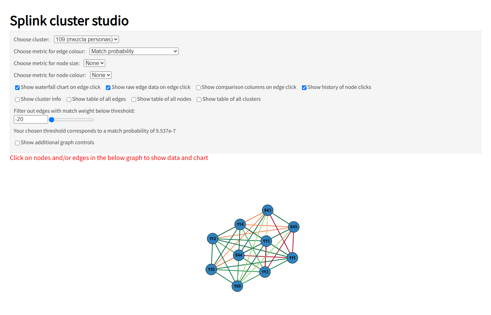

# Resolución de identidades con Splink

Caso de uso 1 de un portafolio de ciencia de datos y agentes aplicado a banca: detectar qué
registros de una base de clientes corresponden a la misma persona, explicar cada decisión y
medir su precisión contra la verdad conocida.

- [Descripción del caso](caso-01-identidades.md)
- Código: [github.com/stous1/identity-resolution](https://github.com/stous1/identity-resolution)

## Hito 1: fake_1000

1.000 registros de 251 personas (dataset de demostración de Splink), divididas por persona en
desarrollo (60 %) y prueba (40 %). En desarrollo se eligen las reglas de bloqueo, se entrena un
modelo Fellegi-Sunter sin etiquetas y se elige el umbral que minimiza el costo de errores por
clúster (un falso positivo cuesta 10 veces más que un falso negativo). Las métricas se miden
una sola vez en prueba, con intervalos de confianza del 95 % por bootstrap de personas.

**Prueba (100 personas, umbral 0,83):**

| Nivel | Precisión | Recall | F1 |
|---|---|---|---|
| Por par | 0,998 [0,991 – 1,000] | 0,709 [0,649 – 0,761] | 0,829 [0,786 – 0,864] |
| Por clúster | 0,970 [0,864 – 1,000] | 0,851 [0,790 – 0,903] | 0,907 [0,845 – 0,946] |

73 de las 100 personas quedan reconstruidas exactamente. Medidas sobre todo el dataset, con
reglas y umbral elegidos sobre esos mismos datos, las métricas serían optimistas (precisión
1,000 y recall 0,903 por clúster). Detalle en [metricas.json](resultados/metricas.json),
[seleccion_bloqueos.csv](resultados/seleccion_bloqueos.csv) y
[comparacion_bloqueos.csv](resultados/comparacion_bloqueos.csv).

## Tableros

De prueba:

- [Cascada por par](resultados/cascada.html): cómo cada campo suma o resta evidencia
  (aciertos, falsos positivos y falsos negativos).
- [Cluster Studio](resultados/cluster_studio.html): grafo de cada clúster, empezando por los
  que tienen errores.
- [Comparison viewer](resultados/comparison_viewer.html): ejemplos por patrón de comparación.

De desarrollo:

- [Parámetros m/u](resultados/parametros_mu.html) y
  [pesos de coincidencia](resultados/pesos.html) del modelo entrenado.
- Curvas por umbral: [por par](resultados/curva_umbral.html),
  [por clúster](resultados/curva_umbral_clusters.html) y [costo](resultados/costo_umbral.html).

## Regla de datos

Este proyecto nunca usa datos reales de clientes: solo datasets públicos de demostración
(Splink, FEBRL) o sintéticos generados con Faker.
