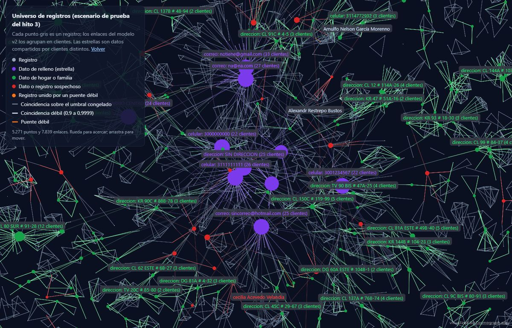

# Resolución de identidades con Splink

**¿Cuáles registros de una base de clientes son la misma persona?** Un modelo probabilístico
(Fellegi-Sunter con Splink y DuckDB) que lo decide, explica cada decisión y se mide contra
la verdad conocida, con pruebas ciegas y una auditoría independiente. Todo con datos
sintéticos.

**[Probar la demo →](demo.html)** · **[Calculadora de impacto →](calculadora.html)** ·
[universo en Cosmograph](hito3_universo.html)

## En un minuto

- **v1.1, realidad residencial colombiana** ([página](v11.md)): parejas sin apellidos en
  común, convivientes, conjuntos y casas de varios pisos. En la **prueba ciega 4**, el
  modelo v4 (dirección por predio y unidad) sube el F1 de 0,987 a **0,994** frente al v3, y
  el grafo residencial baja las personas inocentes marcadas como sospechosas de 36,7 % a
  **1,6 %**, aunque detecta menos patrones sospechosos (66,7 % de sus personas frente a
  81,6 %).
- **Prueba ciega 3** (modelo v3 congelado, errores de un generador independiente):
  precisión **0,997** y recall **0,966** por clúster; 94,5 % de las personas reconstruidas
  exactamente.
- **Frente a reglas simples:** +0,065 de F1 sobre la mejor regla determinística; la
  ganancia está donde el documento falta o viene alterado.
- **1 millón de registros** en una máquina en 129 s (7,1 GB de pico), con precisión 0,998.
- **"¿Ya es cliente?"** en unos 120 ms: precisión 0,999 si la mitad de las consultas son de
  clientes, 0,938 si solo lo es el 1 %.
- **Auditoría independiente:** sin fugas de etiquetas y con todas las cifras reproducibles;
  sus hallazgos se corrigieron o matizaron en el [hito 6](hito6.md).

| Prueba | Modelo | Precisión | Recall | F1 Splink | F1 mejor regla |
|---|---|---|---|---|---|
| **Ciega 3** | **v3** | **0,997** | **0,966** | **0,981** | 0,916 |
| Ciega 2 | v2 | 0,998 | 1,000 | 0,999 | 0,990 |
| Ciega 1 | v1 | 0,997 | 0,636 | 0,777 | 0,960 |
| FEBRL3 | propio | 1,000 | 0,997 | 0,998 | 0,957 |
| 1 millón de registros | v3 | 0,998 | 0,995 | 0,997 | 0,924 |

Limitaciones: datos sintéticos, generadores de errores escritos por agentes de IA y sin
validación con datos reales.

**Más:** [descripción del caso](caso-01-identidades.md) ·
[código e informe técnico](https://github.com/stous1/identity-resolution/blob/main/INFORME_TECNICO.md) ·
[auditoría](https://github.com/stous1/identity-resolution/blob/main/audit/INFORME.md) ·
[verificación del hito 6](https://github.com/stous1/identity-resolution/blob/main/audit/verificacion_hito6.md) ·
[repositorio](https://github.com/stous1/identity-resolution)

## Hitos

- [Hito 1: fake_1000](#hito-1-fake_1000): el flujo completo sobre el dataset de
  demostración de Splink.
- [Hito 2: clientes sintéticos colombianos y estandarización](hito2.md): en la prueba
  normal, precisión 1,000 y recall 0,998 por clúster. En la **prueba ciega** (modelo
  congelado, errores de un generador independiente), precisión 0,997 y recall 0,636: la
  cifra honesta. FEBRL3: precisión 1,000 y recall 0,997. *La auditoría mostró que ese
  recall se perdió sobre todo por dos vetos aprendidos (municipio y dirección), no por los
  errores de nombre, y que la brecha del apellido de casada no era significativa sin
  ellos.*
- [Hito 2b: corregir y volver a medir a ciegas](hito2b.md): con las correcciones (apellido
  de casada, apodos, nombres cruzados, documento, teléfonos y fechas), en una **segunda
  prueba ciega**, precisión 0,998 y recall 1,000 por clúster; el modelo anterior, en esos
  mismos datos, 0,995 y 0,920.
- [Hito 3: registro de oro, grafo de identidad compartida y puentes](hito3.md): registro de
  oro a menos de 5 puntos del techo alcanzable, grupos de datos compartidos clasificados
  en relleno, hogar o sospechoso (98,6 % ± 0,8 en 8 semillas), puentes que evitan en
  promedio 3 de cada 10 mezclas (sin perder recall con la semilla publicada), y el
  [universo de registros en Cosmograph](hito3_universo.html).
- [Hito 5: vinculación en tiempo real y escala](hito5.md): "¿ya es cliente?" contra la base
  de registros de oro con precisión 0,999, recall 0,993 y 60 ms de mediana por consulta;
  1 millón de registros en DuckDB en 134 s con 9,1 GB de pico, y el
  [universo grande en Cosmograph](hito5_universo.html) (200 mil registros desde Parquet).
  *Con las mismas tasas, la precisión sería 0,991 con 10 % de clientes existentes en las
  consultas y 0,909 con 1 %.*
- [v1.1: realidad residencial y familiar colombiana](v11.md): [diagnóstico](v11_diagnostico.md),
  generador con predios y hogares, modelo v4 con la dirección en predio y unidad, grafo
  residencial (convivencia probable, multifamiliar, parejas por apellido de casada y por la
  convención de los hijos) y **prueba ciega 4**; [universo residencial](v11_universo.html).
- [Hito 6: correcciones post-auditoría](hito6.md): modelo v3 sin vetos extremos (ningún
  campo resta más de 10 bits), generador con mudanzas, **prueba ciega 3** (v3: precisión
  0,997 y recall 0,966; v2: 0,994 y 0,978; v1: 0,989 y 0,693; con el umbral del v2, el v3
  tendría más recall), línea base determinística (Splink aporta +0,065 de F1 global sobre
  la mejor regla, sobre todo donde el documento falla), calibración y zona gris por bandas
  de peso (también en "¿ya es cliente?"), escala con el modelo congelado y hito 3 con
  varias semillas.

## Hito 1: fake_1000

1.000 registros de 251 personas (dataset de demostración de Splink), divididas por persona en
desarrollo (60 %) y prueba (40 %). En desarrollo se eligen las reglas de bloqueo, se entrena un
modelo Fellegi-Sunter sin etiquetas y se elige el umbral que minimiza el costo de errores por
clúster (un falso positivo cuesta 10 veces más que un falso negativo). Las métricas se miden
una sola vez en prueba, con intervalos de confianza del 95 % por bootstrap de personas.

**Prueba (100 personas, umbral 0,83):**

| Nivel | Precisión | Recall | F1 |
|---|---|---|---|
| Por par | 0,998 [0,991 – 1,000] | 0,709 [0,649 – 0,761] | 0,829 [0,786 – 0,864] |
| Por clúster | 0,970 [0,864 – 1,000] | 0,851 [0,790 – 0,903] | 0,907 [0,845 – 0,946] |

73 de las 100 personas quedan reconstruidas exactamente. Medidas sobre todo el dataset, con
reglas y umbral elegidos sobre esos mismos datos, las métricas serían optimistas (precisión
1,000 y recall 0,903 por clúster). Detalle en [metricas.json](resultados/metricas.json),
[seleccion_bloqueos.csv](resultados/seleccion_bloqueos.csv) y
[comparacion_bloqueos.csv](resultados/comparacion_bloqueos.csv).

## Tableros

De prueba:

- [Cascada por par](resultados/cascada.html): cómo cada campo suma o resta evidencia
  (aciertos, falsos positivos y falsos negativos).
- [Cluster Studio](resultados/cluster_studio.html): grafo de cada clúster, empezando por los
  que tienen errores.
- [Comparison viewer](resultados/comparison_viewer.html): ejemplos por patrón de comparación.

De desarrollo:

- [Parámetros m/u](resultados/parametros_mu.html) y
  [pesos de coincidencia](resultados/pesos.html) del modelo entrenado.
- Curvas por umbral: [por par](resultados/curva_umbral.html),
  [por clúster](resultados/curva_umbral_clusters.html) y [costo](resultados/costo_umbral.html).

## Regla de datos

Este proyecto nunca usa datos reales de clientes: solo datasets públicos de demostración
(Splink, FEBRL) o sintéticos generados con Faker.
