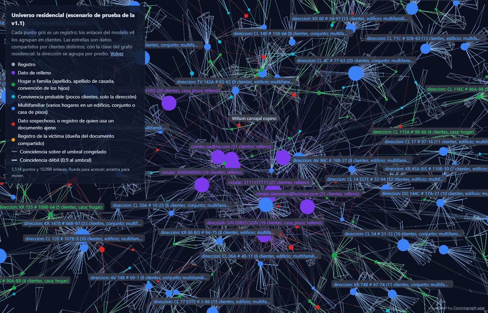

# v1.1: realidad residencial y familiar colombiana

[← Volver a la portada](index.md) ·
[Diagnóstico previo](v11_diagnostico.md) ·
[Universo residencial](v11_universo.html) ·
[Detalle en el informe técnico](https://github.com/stous1/identity-resolution/blob/main/INFORME_TECNICO.md#v11-realidad-residencial-y-familiar-colombiana)

En Colombia muchas personas sin parentesco comparten la dirección: parejas sin apellidos
en común, estudiantes que comparten arriendo, cientos de hogares en un mismo conjunto
(distinguidos solo por torre y apartamento) y casas donde "le echaron la plancha" y el
hijo vive con su familia en el segundo piso. El grafo del hito 3 no estaba preparado para
eso: marcaba como sospechosas a las parejas, tomaba por relleno toda dirección con
apartamento y no veía a los vecinos de un edificio.

Universo del escenario residencial de prueba con el v4 y el grafo residencial
congelados. Azul: varios hogares en un predio; cian: convivencia probable; verde: hogar;
rojo: sospechoso o suplantador; ámbar: víctima (la dueña del documento que otro usó).

## Qué encontró el diagnóstico

[Diagnóstico completo →](v11_diagnostico.md)

- **Toda dirección con complemento era relleno.** La estandarización v1 solo reconoce la
  dirección si termina en el consecutivo. "Carrera 7 # 40-62 Apto 502" quedaba como texto,
  el grafo la marcaba como genérica y "Ap 502" era otro valor.
- **La única señal de hogar era compartir apellido.** Una pareja sin apellidos en común
  salía sospechosa; el apellido de casada no se reconocía, y la partícula "DE" contaba como
  apellido común entre dos señoras casadas sin relación.
- **El v3 pesaba la dirección al revés:** el mismo apartamento escrito de dos formas restaba
  1,7 bits y dos vecinos del edificio sumaban 5,4. Dos predios de la misma cuadra sumaban
  8,8. El ajuste por frecuencia existía, pero solo en el nivel de dirección exacta.
- **"Esther Nancy MONTENEGRO MUÑOZ"** en rojo en el universo del hito 3 es una suplantación
  creada a propósito por el escenario: el clasificador acierta, pero el universo pintaba a
  la víctima igual que a la suplantadora. Además, el escenario del hito 3 cambia con la
  fecha del día (Faker); se reproduce con la fecha fija.

## Qué cambió

1. **Generador residencial** (`escenario_residencial.py`): población desde predios (casa,
   casa de varios pisos, edificio, conjunto) y hogares (parejas casadas o en unión libre,
   familias con hijos "Ramírez Torres", monoparentales, hermanos, convivientes), con apellido
   de casada, complementos escritos de muchas formas u omitidos, llegadas, mudanzas y
   ocupación sucesiva. No cambia los generadores anteriores.
2. **Modelo v4** (tag `v4-congelado`): la dirección se separa en predio y unidad
   (`estandarizacion_v4.py`) y se compara por niveles, con ajuste por frecuencia.

   | Nivel | v3 | v4 |
   |---|---|---|
   | Mismo apartamento, otra escritura | −1,7 | **+11,8** |
   | Casa sin piso contra "Piso 2" | −1,7 | +7,3 |
   | Mismo conjunto, con y sin apartamento | −1,7 | +10,7 |
   | Mismo edificio, otro apartamento | +5,4 | **+3,6** |
   | Otro predio en la misma cuadra | +8,8 | +4,8 |

   Bits sin el ajuste por frecuencia, que baja el peso en los predios con muchos clientes.
3. **Grafo residencial** (tag `grafo-v11-congelado`): la dirección se agrupa por predio.
   Hay señales de hogar por apellido sin partículas, por apellido de casada, por la
   convención de los hijos (un hijo "Ramírez Torres" conecta a "Ramírez" con "Torres") y
   por un contacto compartido. La sospecha depende del tipo de dato, del tamaño, de la
   forma de anillo y del tipo de predio, que se estima. Hay clases nuevas: **convivencia
   probable** y **multifamiliar**. El universo distingue víctima y suplantador.
4. **Prueba ciega 4**: un subagente nuevo, sin acceso a la estandarización, los modelos,
   los generadores anteriores, la documentación ni el historial, escribió su propio
   generador residencial después de congelar el v4 y el grafo. Tiene 2.000 personas,
   4.844 registros y 23 valores sospechosos.

## Resultados

### Grafo de identidad compartida, 8 pares de escenarios residenciales

Cada clasificador elige sus parámetros en el escenario de desarrollo y se mide una vez en
el de prueba. Media ± desviación estándar entre los 8 pares.

| | Grafo del hito 3 (clústeres del v3) | Grafo residencial (clústeres del v4) |
|---|---|---|
| Exactitud balanceada | 0,508 ± 0,035 | **0,925 ± 0,034** |
| Grupos benignos marcados sospechosos | 39,1 % ± 3,7 | **0,5 % ± 0,3** |
| Personas inocentes marcadas | 36,8 % ± 4,0 | **0,2 % ± 0,1** |
| Recall de sospechosos | 0,976 ± 0,028 | 0,990 ± 0,021 |
| Precisión de sospechosos | 0,194 ± 0,020 | **0,945 ± 0,027** |

Falsa sospecha del grafo del hito 3 por tipo de grupo: parejas 83 %, convivientes 86 %,
hogares de un mismo predio multifamiliar 80 %. El tipo de predio se estima bien en el
88 % ± 2 de los grupos de dirección.

### Prueba ciega 4

**Unión de registros** (por clúster, IC 95 % por bootstrap de personas):

| Modelo | Precisión | Recall | F1 | Personas exactas |
|---|---|---|---|---|
| v3 | 0,995 (0,983 a 1,000) | 0,979 (0,972 a 0,985) | 0,987 (0,980 a 0,992) | 96,5 % |
| **v4** | 0,995 (0,984 a 1,000) | **0,993** (0,990 a 0,996) | **0,994** (0,988 a 0,997) | **98,0 %** |

Diferencia pareada v4 − v3: F1 **+0,007** (0,004 a 0,011), recall +0,014 (0,008 a
0,021), precisión +0,0001. Pares verdaderos rechazados por un solo campo: 132 con el v3,
64 con el v4.

**Equidad:** con el v3 había brechas significativas: más personas exactas entre las mujeres
(+1,8 puntos), menos recall para quienes no usan apellido de casada y menos para quienes
viven en edificio o conjunto (−1,2 puntos). Con el v4 **no se detecta ninguna brecha** en
esos grupos ni en las casas de varios pisos y los convivientes (todos los intervalos
incluyen el cero).

**Grafo** (los dos congelados: el del hito 3 con sus parámetros publicados):

| | Grafo del hito 3 | Grafo residencial |
|---|---|---|
| Exactitud (predicción aceptable) | 0,641 (0,594 a 0,684) | **0,942** (0,922 a 0,960) |
| Grupos benignos marcados sospechosos | 36,0 % (31,1 a 41,0) | **0,6 %** (0,0 a 1,2) |
| Personas inocentes marcadas | 289 de 788 (36,7 %) | **28 de 1.697 (1,6 %)** |
| Grupos sospechosos detectados | 14 de 17 | 13 de 17 |
| Personas de patrones sospechosos detectadas | **81,6 %** | 66,7 % |

Diferencia pareada por persona (residencial − hito 3): inocentes marcadas −34,0 puntos
(−37,3 a −30,7); personas de patrones detectadas −14,9 puntos (−27,6 a −2,3).

**El grafo residencial detecta menos patrones sospechosos en la ciega 4.** Tres anillos de
celular de 7 clientes quedaron como relleno: el grafo toma por relleno un contacto
compartido por más de 6 clientes, y los anillos del escenario propio eran de 3 a 6. Una
"dirección de fachada" con 9 clientes y un tercio de registros validados no tuvo la forma
de anillo. Corregirlo requiere mirar la forma de anillo antes que el tamaño, y una prueba
ciega 5.

### Otras pruebas

- **Prueba normal del hito 2:** el v3 y el v4 son idénticos (F1 0,998): no hay unidades.
- **Ciega 3** (ya mirada; solo como referencia): F1 0,980 con el v3 y 0,982 con el v4
  (diferencia +0,002, −0,002 a 0,005); el recall sube 0,006 y la precisión baja 0,003.
  El v3 da aquí 0,961 de recall y no el 0,966 publicado en el hito 6: el generador de la
  ciega 3 parte de personas de `sinteticos`, que dependen de la fecha del día (Faker), así
  que hoy genera otros datos. La comparación v3 contra v4 es pareada sobre los mismos
  datos. La ciega 4 y los escenarios de la v1.1 usan una fecha fija.
- **Escenarios residenciales de prueba:** v3 y v4 casi iguales (F1 0,998 ± 0,0004 y
  0,999 ± 0,0004): en el generador propio, el v3 ya unía bien.

## Limitaciones

- **La distribución real de conjuntos, edificios y casas de varios pisos solo se puede
  calibrar con datos reales.** Las proporciones de tipos de predio y de hogar, cuántos
  clientes de un banco viven en un mismo conjunto, con qué frecuencia se omite el
  apartamento o se escribe el piso, y los umbrales de tamaño del grafo salen de supuestos
  sintéticos.
- Los dos generadores residenciales y el de la ciega 4 los escribieron agentes de IA. La
  ciega 4 es independiente del modelo, pero no reproduce la realidad.
- La verdad de "pareja" no se distingue de "convivientes" sin otras señales: las dos
  predicciones se aceptan como correctas.
- Las ciegas 1 a 4 ya se miraron: la próxima corrección necesita una ciega 5.
- La demo en el navegador y "¿ya es cliente?" siguen con el v3.
